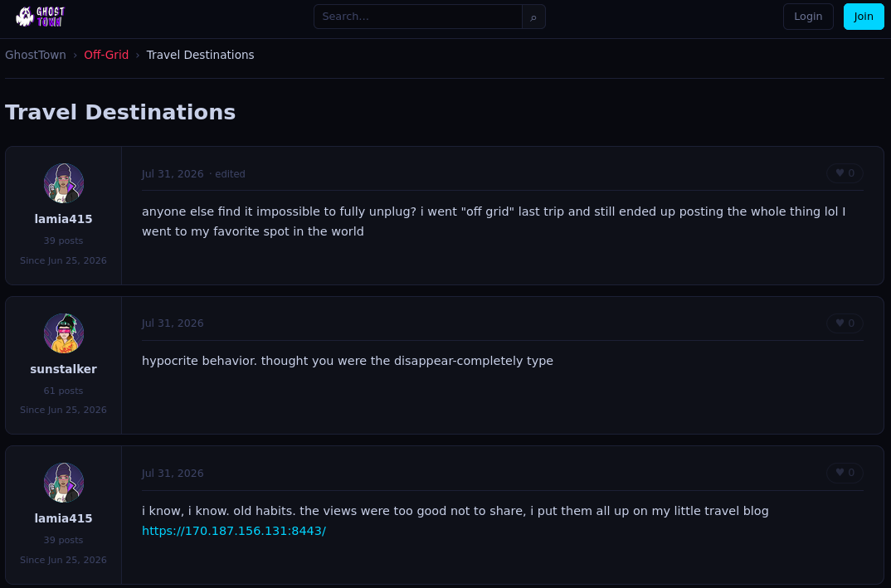
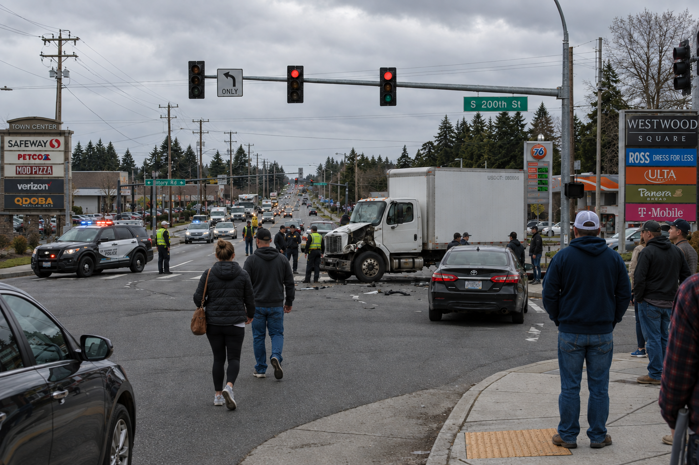

* TOC
{:toc}

## Chatty Cathy

**Category**: osint

**Created By**: `@RP-01?`

**Description**: There is a DEADFACE member who writes a travel blog under the pseudonym "Alice". Can you check GhostTown and see if you can find the travel blog? We suspect the site may contain information needed to track down this DEADFACE member.

I went to GhostTown at [https://ghosttown.deadface.io/](https://ghosttown.deadface.io) and searched for `travel`. That brought me to the post at [https://ghosttown.deadface.io/t/20/travel-destinations](https://ghosttown.deadface.io/t/20/travel-destinations). 

The user `lamia415` posted about having a travel blog hosted at [https://170.187.156.131:8443/](https://170.187.156.131:8443/):



On `https://170.187.156.131:8443/`:


Eventually I checked `robots.txt`:
```shell
curl -k https://170.187.156.131:8443/robots.txt  
User-agent: *  
Disallow: /secret_members  
# deadface{y0u_m3ddling_k!ds}
```

`deadface{y0u_m3ddling_k!ds}`

___

## Exposing Myself Through Bad OPSEC

**Category**: osint

**Created By**: `@RP-01?`

**Description**: Now that you've found the DEADFACE member's travel blog, what else can we determine about this site and this member? Perhaps the site's certificate can tell us more.

Check the cert for the site:
```shell
openssl s_client -connect 170.187.156.131:8443 -showcerts </dev/null  
Connecting to 170.187.156.131  
CONNECTED(00000003)  
Can't use SSL_get_servername  
depth=0 C=US, ST=Louisiana, L=New Orleans, O=Deadface{c@tch_m3_if_y0u_c@n}, OU=Operations, CN=170.187.156.131, emailAddress=alicehankerty@gmail.com  
verify error:num=18:self-signed certificate  
verify return:1  
depth=0 C=US, ST=Louisiana, L=New Orleans, O=Deadface{c@tch_m3_if_y0u_c@n}, OU=Operations, CN=170.187.156.131, emailAddress=alicehankerty@gmail.com  
verify return:1  
---  
Certificate chain  
 0 s:C=US, ST=Louisiana, L=New Orleans, O=Deadface{c@tch_m3_if_y0u_c@n}, OU=Operations, CN=170.187.156.131, emailAddress=alicehankerty@gmail.com  
   i:C=US, ST=Louisiana, L=New Orleans, O=Deadface{c@tch_m3_if_y0u_c@n}, OU=Operations, CN=170.187.156.131, emailAddress=alicehankerty@gmail.com  
   a:PKEY: RSA, 2048 (bit); sigalg: sha256WithRSAEncryption  
   v:NotBefore: Jul 31 01:23:54 2026 GMT; NotAfter: Nov  2 01:23:54 2028 GMT  
-----BEGIN CERTIFICATE-----  
MIIEVTCCAz2gAwIBAgIUWAvWfl21xWMxplvww1USiC4ati8wDQYJKoZIhvcNAQEL  
BQAwgbYxCzAJBgNVBAYTAlVTMRIwEAYDVQQIDAlMb3Vpc2lhbmExFDASBgNVBAcM  
C05ldyBPcmxlYW5zMSYwJAYDVQQKDB1EZWFkZmFjZXtjQHRjaF9tM19pZl95MHVf  
Y0BufTETMBEGA1UECwwKT3BlcmF0aW9uczEYMBYGA1UEAwwPMTcwLjE4Ny4xNTYu  
MTMxMSYwJAYJKoZIhvcNAQkBFhdhbGljZWhhbmtlcnR5QGdtYWlsLmNvbTAeFw0y  
NjA3MzEwMTIzNTRaFw0yODExMDIwMTIzNTRaMIG2MQswCQYDVQQGEwJVUzESMBAG  
A1UECAwJTG91aXNpYW5hMRQwEgYDVQQHDAtOZXcgT3JsZWFuczEmMCQGA1UECgwd  
RGVhZGZhY2V7Y0B0Y2hfbTNfaWZfeTB1X2NAbn0xEzARBgNVBAsMCk9wZXJhdGlv  
bnMxGDAWBgNVBAMMDzE3MC4xODcuMTU2LjEzMTEmMCQGCSqGSIb3DQEJARYXYWxp  
Y2VoYW5rZXJ0eUBnbWFpbC5jb20wggEiMA0GCSqGSIb3DQEBAQUAA4IBDwAwggEK  
AoIBAQDVpR/encsBPLBPlrRMn479OxhRNH3mEtUPgD0UrHegWSifChbQyuCkqG9n  
fJtKzL4RZo8/zQmmVFmFq5X6WQbxkkgmJ1q4b/aiAAV5W21dYlDA5Dq7ObkdqtbY  
Yapd+77Owcq+abN5MbIOmEZGMrJejKSy3u0LQM2A0L1sW5jVht2i/X7MtRu/PGhI  
6o+/37uUXp5BS1gEjgM7YtMSUESKhkmBlEwDV8tTop/LxlgSY8M4x82oDo7WMon+  
e5IxF7XveCnI7Kywc7LQqQJXjMmRTKRGS5Uw0RnDo5OEkNRaMXpAL0fXhupoWggl  
sSLIBuLjY1xg4ZeUtYxrsuuI3j87AgMBAAGjWTBXMDYGA1UdEQQvMC2HBKq7nIOC  
DGRlYWRmYWNlLmN0ZoEXYWxpY2VoYW5rZXJ0eUBnbWFpbC5jb20wHQYDVR0OBBYE  
FLL4VqLJM7LZSxmU0zajRYcokUOtMA0GCSqGSIb3DQEBCwUAA4IBAQCgGZMJwwxP  
bv6+XR0FqEVRF6egYu7gOxLvs9Le1cVNUPYUWkWweJEFhH5WN2o7Ez9evNpmmPIe  
1qJl9lQidDUljB8m/F+QzJnZyGrPFgZ6mTdYve8Nw1wnMTtBtM3bA5OGKmFU60I9  
S12RcEPuQlFKyBcZBP/+e87lvqtdQpvFOvRegf5FmZGEpNjRzbeu16b7UTsxHn+L  
ANmwk8d/sRVzcl6Mc87bzTeqO6ZGnB71t/mVVjUMfRWsw8Sgcser8vGsMZE2bX1R  
vXE4dnUf45nIQpEDCJO8bZMJ57kZXX1xIxwqZsxTrd2B/a7p+eROy+xgR0Y6O1FR  
v8FKbs31CtLL  
-----END CERTIFICATE-----  
---  
Server certificate  
subject=C=US, ST=Louisiana, L=New Orleans, O=Deadface{c@tch_m3_if_y0u_c@n}, OU=Operations, CN=170.187.156.131, emailAddress=alicehankerty@gmail.com  
issuer=C=US, ST=Louisiana, L=New Orleans, O=Deadface{c@tch_m3_if_y0u_c@n}, OU=Operations, CN=170.187.156.131, emailAddress=alicehankerty@gmail.com  
---  
No client certificate CA names sent  
Peer signing digest: SHA256  
Peer signature type: rsa_pss_rsae_sha256  
Negotiated TLS1.3 group: X25519MLKEM768  
---  
SSL handshake has read 2757 bytes and written 1613 bytes  
Verification error: self-signed certificate  
---  
New, TLSv1.3, Cipher is TLS_AES_256_GCM_SHA384  
Protocol: TLSv1.3  
Server public key is 2048 bit  
This TLS version forbids renegotiation.  
Compression: NONE  
Expansion: NONE  
No ALPN negotiated  
Early data was not sent  
Verify return code: 18 (self-signed certificate)  
---  
DONE
```

`Deadface{c@tch_m3_if_y0u_c@n}`

___

## Car Crash

**Category**: osint

**Created By**: `@RP-01?`

**Description**: DEADFACE has been researching companies connected to one of their latest targets. Among the files recovered was a photo of a traffic accident involving a commercial truck.

We believe the truck may identify a company DEADFACE has taken an interest in. Determine which company owns the truck and when that company was founded.

Challenge image:



The text on the truck says: `USDOT: 080806`

I looked up the number here: [https://motus.dot.gov/public/search?q=080806](https://motus.dot.gov/public/search?q=080806)

The company that came back was `J B HUNT`.

I went to `https://en.wikipedia.org/wiki/J._B._Hunt` and found the company was founded August 10th 1961.

`deadface{08_10_1961}`

___

## The Vibes Are Freaking Me Out

**Category**: osint

**Created By**: `@Cyb0rgSw0rd`

**Description**: We've received intelligence that a DEADFACE operative may have been using Al to create a browser extension that would enable them to communicate openly outside of the GhostTown forums using a new model called Maude. We need to find the tool they've built so we can find out what they're trying to hide from us.

I found a post on the forum here: [https://ghosttown.deadface.io/t/37/i-built-something?page=1](https://ghosttown.deadface.io/t/37/i-built-something?page=1) 

The user [b1tfr34k](https://ghosttown.deadface.io/u/b1tfr34k) was talking about their browser extension. 

I found the github repo for the tool here: [https://github.com/fr34ked0ut/HIPS](https://github.com/fr34ked0ut/HIPS)

I looked through the git history for a while. There was a few rabbit holes including a `.env` file which was committed. Eventually I found the flag on this page: [https://github.com/fr34ked0ut/HIPS/commit/90b1aae6983c74daa0932cb8df913f4c59b9294a](https://github.com/fr34ked0ut/HIPS/commit/90b1aae6983c74daa0932cb8df913f4c59b9294a)

`deadface{A11_Th1s_Pr0mpt1ng_G3ts_M3_N0wh3r3!}`
