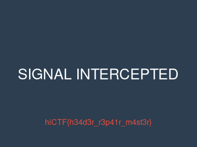

* TOC
{:toc}

## Broken Signals

**Author**: @archnexus707

**Category**: Forensics

**Description**: Our signals intelligence team intercepted a file during a routine sweep, but it appears corrupted. The file cannot be opened by any standard application. Something is wrong with the file itself — can you repair it and recover the hidden message?

I get the challenge file:
```shell
file broken_signal.dat  
broken_signal.dat: data

xxd broken_signal.dat | head  
00000000: 0000 0000 0d0a 1a0a 0000 000d 4948 4452  ............IHDR  
00000010: 0000 0190 0000 012c 1006 0000 00bd 2739  .......,......'9  
00000020: 8100 0000 2063 4852 4d00 007a 2600 0080  .... cHRM..z&...  
00000030: 8400 00fa 0000 0080 e800 0075 3000 00ea  ...........u0...  
00000040: 6000 003a 9800 0017 709c ba51 3c00 0000  `..:....p..Q<...  
00000050: 0662 4b47 44ff ffff ffff ff09 58f7 dc00  .bKGD.......X...  
00000060: 0000 0774 494d 4507 ea0a 0f0b 3737 4d37  ...tIME.....77M7  
00000070: 7069 0000 0025 7445 5874 6461 7465 3a63  pi...%tEXtdate:c  
00000080: 7265 6174 6500 3230 3236 2d31 302d 3135  reate.2026-10-15  
00000090: 5431 313a 3535 3a35 352b 3030 3a30 302b  T11:55:55+00:00+
```

The PNG header is corrupted. It starts with `00 00 00 00`. It should start with `89 50 4E 47`. Fixed image:



`hiCTF{h34d3r_r3p41r_m4st3r}`

___

## Ghost in the Wire

**Author**: @archnexus707

**Category**: Forensics

**Description**: Our network monitoring team detected anomalous ICMP traffic during a routine packet capture. Something is being exfiltrated through the wire — but the data blends in with normal network noise. Analyze the capture and extract the hidden message before the ghost disappears.

Challenge file:
```shell
file ghost_traffic.pcap  
ghost_traffic.pcap: pcap capture file, microsecond ts (little-endian) - version 2.4 (Ethernet, capture length 65535)
```

I run this command to get just the data from the icmp packets:
```shell
tshark -r ghost_traffic.pcap -Y "icmp.type == 8" -T fields -e data  
41414141414141414141414141414141  
70696e672066726f6d2073657276657231  
68  
69  
43  
54  
46  
7b  
31  
63  
6d  
70  
5f  
33  
78  
66  
31  
6c  
5f  
64  
33  
74  
33  
63  
74  
33  
64  
7d  
6865616c746820636865636b206f6b2020  
6d6f6e69746f7220616c69766520303031
```

[cyberchef link](https://gchq.github.io/CyberChef/#recipe=Remove_whitespace(true,true,true,true,true,false)From_Hex('None')&input=NDE0MTQxNDE0MTQxNDE0MTQxNDE0MTQxNDE0MTQxNDEKNzA2OTZlNjcyMDY2NzI2ZjZkMjA3MzY1NzI3NjY1NzIzMQo2OAo2OQo0Mwo1NAo0Ngo3YgozMQo2Mwo2ZAo3MAo1ZgozMwo3OAo2NgozMQo2Ywo1Zgo2NAozMwo3NAozMwo2Mwo3NAozMwo2NAo3ZAo2ODY1NjE2Yzc0NjgyMDYzNjg2NTYzNmIyMDZmNmIyMDIwCjZkNmY2ZTY5NzQ2ZjcyMjA2MTZjNjk3NjY1MjAzMDMwMzE)

`hiCTF{1cmp_3xf1l_d3t3ct3d}`

___

## Memory Liar

**Author**: otolk1

**Category**: Forensics

**Description**: A critical workstation on the financial management subnet was suspected of being compromised by an advanced persistent threat (APT). Our tier-1 triage team collected a physical memory capture and ran an automated process audit. The automated audit reported everything clean: all running processes appear ordinary, can you retrieve the flag?

I get the challenge file:
```shell
file memory.raw  
memory.raw: data
```

In `strings` output there was decoy data:
```shell
====================================================================  
[CONFIDENTIAL - ENDPOINT INCIDENT LOG]  
Host Audit: SEC-2026-10-19-094  
Status: System integrity validated. No hidden tasks or hooks found.  
Forensics Verification Token: hiCTF{th1s_1s_4_f4k3_d3c0y_fl4g_f0r_n00bs_883a1c}  
====================================================================
```

Only around 100 of the 4096 pages are non zero. Each record is `0x8000` apart and had a name: 
```shell
System 
smss.exe
csrss.exe
wininit.exe
services.exe
lsass.exe
svchost.exe x2
explorer.exe
notepad.exe
```

I found a hidden process at `0x35d000`:
```shell
xxd -s 0x35d000 -l 0x400 memory.raw  
0035d000: 0000 5900 5072 6f63 0000 0000 0000 0000  ..Y.Proc........  
0035d010: 0000 0000 0000 0000 0000 0000 0000 0000  ................  
0035d020: 0070 3500 0000 0000 0000 0000 0000 0000  .p5.............  
0035d030: 0000 0000 0000 0000 0000 0000 0000 0000  ................  
0035d040: 0000 0000 0000 0000 0000 0000 0000 0000  ................  
0035d050: 0000 0000 0000 0000 0000 0000 0000 0000  ................  
0035d060: 0000 0000 0000 0000 0000 0000 0000 0000  ................  
0035d070: 0000 0000 0000 0000 0000 0000 0000 0000  ................  
0035d080: 0000 0000 0000 0000 0000 0000 0000 0000  ................  
0035d090: 0000 0000 0000 0000 0000 0000 0000 0000  ................  
0035d0a0: 0000 0000 0000 0000 0000 0000 0000 0000  ................  
0035d0b0: 0000 0000 0000 0000 0000 0000 3905 0000  ............9...  
0035d0c0: c0d0 3580 c0d0 3580 0000 0000 0000 0000  ..5...5.........  
0035d0d0: 0000 0000 0000 0000 0000 0000 0000 0000  ................  
0035d0e0: 0000 0000 0000 0000 0000 0000 0000 0000  ................  
0035d0f0: 0000 0000 0000 0000 0000 0000 0000 0000  ................  
0035d100: 0000 0000 0000 0000 0000 0000 0000 0000  ................  
0035d110: 0000 0000 0000 0000 0000 0000 0000 0000  ................  
0035d120: 0000 0000 0000 0000 0000 0000 0000 0000  ................  
0035d130: 0000 0000 0000 0000 0000 0000 0000 0000  ................  
0035d140: 0000 0000 0000 0000 0000 0000 0000 0000  ................  
0035d150: 0000 0000 0000 0000 0000 0000 0000 0000  ................  
0035d160: 0000 0000 0000 0000 0000 0000 0000 0000  ................  
0035d170: 0000 0000 7769 6e78 6e65 742e 6578 6500  ....winxnet.exe.  
0035d180: 0000 0000 0000 0000 0000 0000 0000 0000  ................  
0035d190: 98e1 3580 98e1 3580 0000 0000 0000 0000  ..5...5.........  
0035d1a0: 0000 0000 0000 0000 0000 0000 0000 0000  ................  
0035d1b0: 0000 0000 0000 0000 0000 0000 0000 0000  ................  
0035d1c0: 0000 0000 0000 0000 0000 0000 0000 0000  ................  
0035d1d0: 0000 0000 0000 0000 0000 0000 0000 0000  ................  
0035d1e0: 0000 0000 0000 0000 0000 0000 0000 0000  ................  
0035d1f0: 0000 0000 0000 0000 0000 0000 0000 0000  ................  
0035d200: 0000 0000 7402 0000 0100 0000 0000 0000  ....t...........  
0035d210: 0000 0000 0000 0000 0000 0000 0000 0000  ................
... etc ...
```
`winxnet.exe` was running!

The `ROOT` page:
```shell
xxd -s 0x35f000 -l 0x200 memory.raw  
0035f000: 524f 4f54 3905 0000 5d00 0000 3300 0000  ROOT9...]...3...  
0035f010: 3534 1e09 1b26 3936 6d30 0228 3331 6c33  54...&96m0.(31l3  
0035f020: 3602 6e2d 2f6d 3e6e 2e2e 0231 6c2e 2902  6.n-/m>n...1l.).  
0035f030: 3e2f 6d2e 2e02 3e35 6e3e 3602 6a3e 6e3c  >/m...>5n>6.j>n<  
0035f040: 643b 2000 0000 0000 0000 0000 0000 0000  d; .............  
0035f050: 6332 2e64 6172 6b73 6861 646f 772d 6170  c2.darkshadow-ap  
0035f060: 742e 6f72 673a 3834 3433 0000 0000 0000  t.org:8443......  
0035f070: 4f50 5f53 4841 444f 575f 4c49 4152 5f41  OP_SHADOW_LIAR_A  
0035f080: 4354 4956 4500 0000 0000 0000 0000 0000  CTIVE...........  
0035f090: 0000 0000 0000 0000 0000 0000 0000 0000  ................
... etc ...
```
The page starts with the marker `ROOT` followed by:
- PID 0x539 (1337)
- a 51 byte blob
- the C2 string `c2.darkshadow-apt.org:8443`
- `OP_SHADOW_LIAR_ACTIVE`

The blobs first six bytes are:
```shell
35 34 1e 09 1b 26
```
This is the XOR key.

Get the flag:
```shell
python3 - <<'EOF'  
d = open('memory.raw','rb').read()  
i = d.find(bytes.fromhex('35341e091b26'))   # blob start  
blob = d[i:i+51]  
print(bytes(b ^ 0x5d for b in blob).decode())  
EOF  
hiCTF{dk0m_unl1nk_3pr0c3ss_l1st_cr0ss_ch3ck_7c3a9f}
```

`hiCTF{dk0m_unl1nk_3pr0c3ss_l1st_cr0ss_ch3ck_7c3a9f}`
