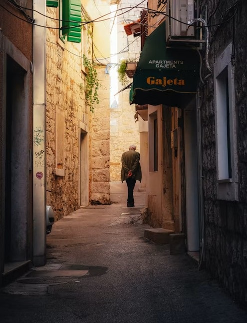
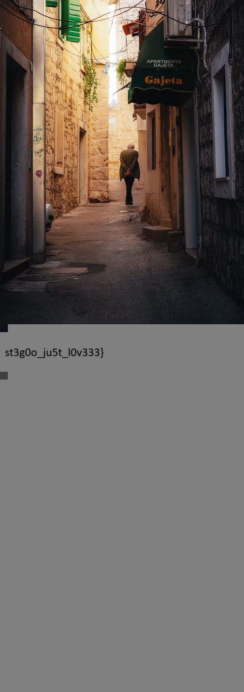

* TOC
{:toc}

## Roof of Africa

**Author**: @archnexus707

**Category**: steg 

**Description**: They say Africa's highest peak holds ancient secrets in its frozen glaciers. A photograph has been intercepted — but its true meaning is locked away, protected by the mountain's most famous number.

Can you reach the summit and uncover what lies hidden?

I get the challenge image:
```shell
file roof_of_africa.jpg  
roof_of_africa.jpg: JPEG image data, JFIF standard 1.01, aspect ratio, density 1x1, segment length 16, baseline, precision 8, 1600x1056, components 3  

exiftool roof_of_africa.jpg  
ExifTool Version Number         : 13.25  
File Name                       : roof_of_africa.jpg  
Directory                       : .  
File Size                       : 625 kB  
File Modification Date/Time     : 2026:10:15 08:48:52-04:00  
File Access Date/Time           : 2026:10:15 07:59:47-04:00  
File Inode Change Date/Time     : 2026:10:30 18:41:06-04:00  
File Permissions                : -rw-rw-r--  
File Type                       : JPEG  
File Type Extension             : jpg  
MIME Type                       : image/jpeg  
JFIF Version                    : 1.01  
Resolution Unit                 : None  
X Resolution                    : 1  
Y Resolution                    : 1  
Image Width                     : 1600  
Image Height                    : 1056  
Encoding Process                : Baseline DCT, Huffman coding  
Bits Per Sample                 : 8  
Color Components                : 3  
Y Cb Cr Sub Sampling            : YCbCr4:4:4 (1 1)  
Image Size                      : 1600x1056  
Megapixels                      : 1.7
```

I ran `stegseek`:
```shell
stegseek --crack -sf roof_of_africa.jpg -wl /usr/share/wordlists/rockyou.txt -t 60  
StegSeek 0.6 - https://github.com/RickdeJager/StegSeek  
  
[i] Found passphrase: "5895" 
[i] Original filename: "roof_flag_v2.txt".  
[i] Extracting to "roof_of_africa.jpg.out".

cat roof_of_africa.jpg.out  
hiCTF{h4kun4_m4t4t4_m34ns_n0_w0rr13s}
```
It found the password `5895`.

`hiCTF{h4kun4_m4t4t4_m34ns_n0_w0rr13s}`

___

## Zanzibar Whisper

**Author**: @archnexus707

**Category**: steg 

**Description**: A mysterious image from the shores of Zanzibar has surfaced. Locals say it carries a hidden message — a whisper from the Spice Island. Can you uncover its secret?

I used `stegseek` again:
```shell
stegseek --crack -sf zanzibar_whisper.jpg -wl /usr/share/wordlists/rockyou.txt -t 60  
StegSeek 0.6 - https://github.com/RickdeJager/StegSeek  
  
[i] Found passphrase: ""  
[i] Original filename: "zanzibar_flag2.txt".  
[i] Extracting to "zanzibar_whisper.jpg.out".  
  
cat zanzibar_whisper.jpg.out  
hiCTF{sp1c3_1sl4nd_s3cr3ts}
```

`hiCTF{sp1c3_1sl4nd_s3cr3ts}`

___

## Whispers in the Margin

**Author**: Hidden Investigations

**Category**: steg 

**Description**: Sometimes the most crucial details are right in front of you, hidden where no one bothers to look. Inspect the provided documents closely—what appears empty might hold the key to unravelling the final secret.

I get two challenge files:
```shell
file 'Those numbers are process counts.docx'  
Those numbers are process counts.docx: Microsoft Word 2007+  

file chall.jpg  
chall.jpg: JPEG image data, JFIF standard 1.02, resolution (DPI), density 72x72, segment length 16, baseline, precision 8, 5182x3455, components 3
```

The docx file contains a message in the whitespace:
```python
import re  
from docx import Document  
 
d = Document('Those numbers are process counts.docx')  
lines = [p.text for p in d.paragraphs if re.fullmatch(r'[ \t]{8,}', p.text)]  
 
print(''.join(  
    chr(int(l.rjust(12).replace(' ', '0').replace('\t', '1'), 2))  
    for l in lines  
))  
 
haha! u got me, now what?
```

I tried it with steghide and got the flag:
```shell
steghide extract -sf chall.jpg -p "haha! u got me, now what?"  
wrote extracted data to "flag.txt".  

cat flag.txt  
hiCTF{573g4n0gr4phy_!5_fun}
```

`hiCTF{573g4n0gr4phy_!5_fun}`

___

## Echoes of a Forgotten Canvas

**Author**: Hidden Investigations

**Category**: steg 

**Description**: A seemingly ordinary file has surfaced with traces of something unusual. It may look complete at first glance, but appearances can be deceiving. Explore the artifact carefully and uncover what was left behind.

I get the challenge file:
```shell
file chall.png  
chall.png: PNG image data, 4000 x 4000, 8-bit/color RGBA, non-interlaced
```
The image does not render. 

The first two lines on the png in a hex editor looked like this:
```shell
00000000  89 50 4e 47 0d 0a 1a 0a 00 00 00 0d 49 48 44 52  |.PNG........IHDR|
00000010  00 00 0f a0 00 00 0f a0 08 06 00 00 00 46 75 41  |... ... .....FuA|
```

I changed line two to look like this:
```shell
00000000  89 50 4e 47 0d 0a 1a 0a 00 00 00 0d 49 48 44 52  |.PNG........IHDR|
00000010  00 00 0f a0 00 00 11 94 08 06 00 00 00 46 75 41  |... ... .....FuA|
```

I now get this image:


In the bottom right of the image is the first part of the flag: `hiCTF{mu1t!14y3r3d_`. You have to zoom way in the see it because the image is large!

Then I ran `foremost` on `chall.png` and got a password protected zip file:
```shell
foremost chall.png  
Processing: chall.png  
|foundat=carrier.jpgUT  
*|
```

Crack the password:
```shell
zip2john 00010778.zip > zip.hash  
ver 2.0 efh 5455 efh 7875 00010778.zip/carrier.jpg PKZIP Encr: TS_chk, cmplen=3358907, decmplen=3364164, crc=4230EEBB ts=14CC cs=14cc type=8

john --show zip.hash  
00010778.zip/carrier.jpg:dreamcatcher:carrier.jpg:00010778.zip::00010778.zip  
  
1 password hash cracked, 0 left
```
The password was `dreamcatcher`.

```shell
unzip 00010778.zip  
Archive:  00010778.zip  
[00010778.zip] carrier.jpg password:  
  inflating: carrier.jpg
```
Now I have `carrier.jpg`.

I ran `stegseek` on `carrier.jpg`:
```shell
stegseek --crack -sf carrier.jpg -wl /usr/share/wordlists/rockyou.txt -t 60  
StegSeek 0.6 - https://github.com/RickdeJager/StegSeek  
  
[i] Found passphrase: "profound"  
  
[i] Original filename: "finall.jpg".  
[i] Extracting to "carrier.jpg.out".
```

It found the password `profound` and extracted a final image called `finall.jpg`:



It is a 495x647 photo of an alley. The JPEG header declares a height of 647.

I found the height in my hexeditor. It looked like this:
```shell
000000c0  0c 0c ff c0 00 11 08 02 87 01 ef 03 01 22 00 02 |..ÿÀ......ï.."..|
```

I made the image taller like this (from `02 87` to `05 78`):
```shell
000000c0  0c 0c ff c0 00 11 08 05 78 01 ef 03 01 22 00 02  |..ÿÀ......ï.."..|
```

This image now contained the last part of the flag:



`hiCTF{mu1t!14y3r3d_st3g0o_ju5t_l0v333}`