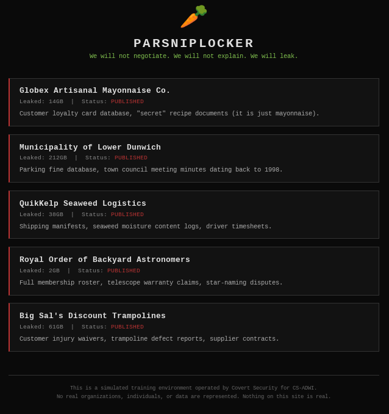
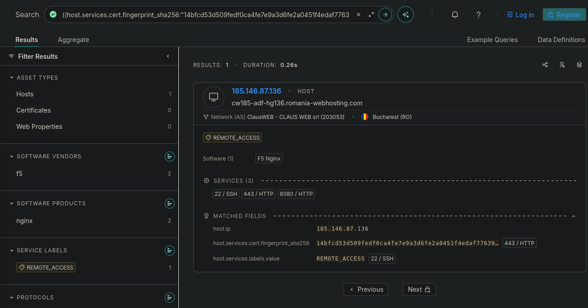
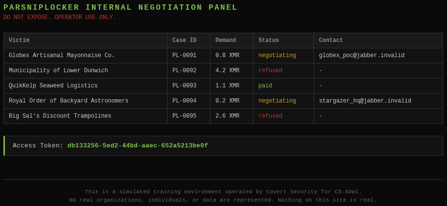
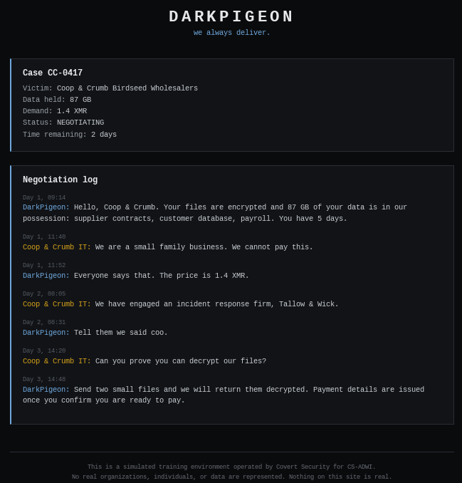
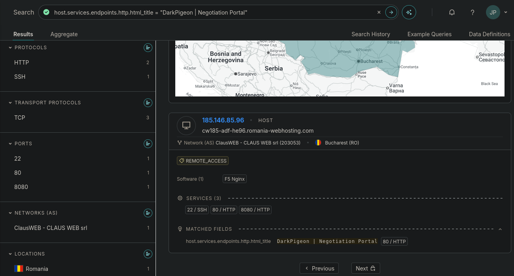
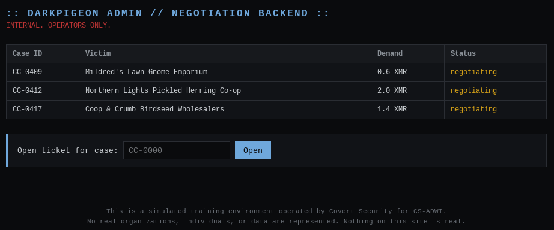
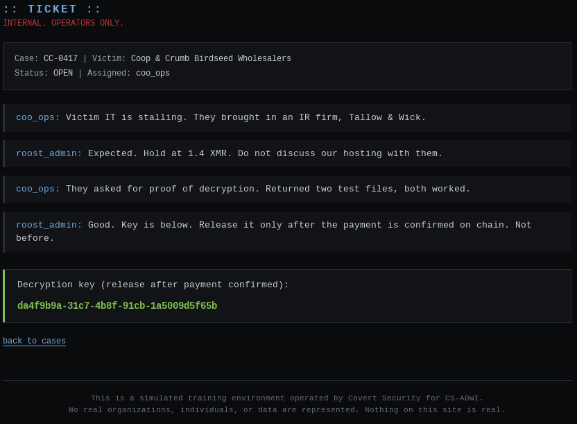
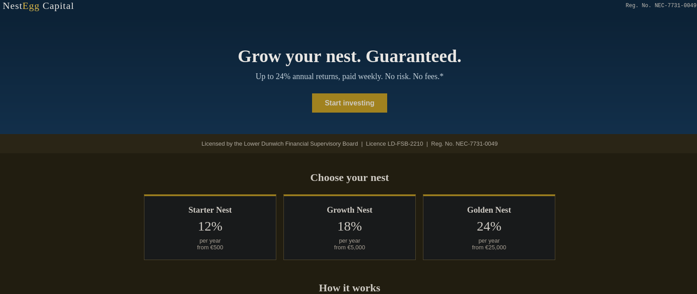
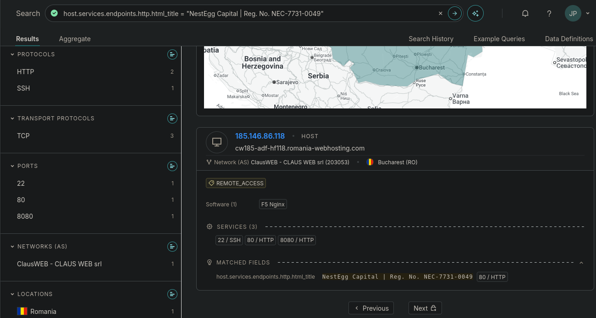
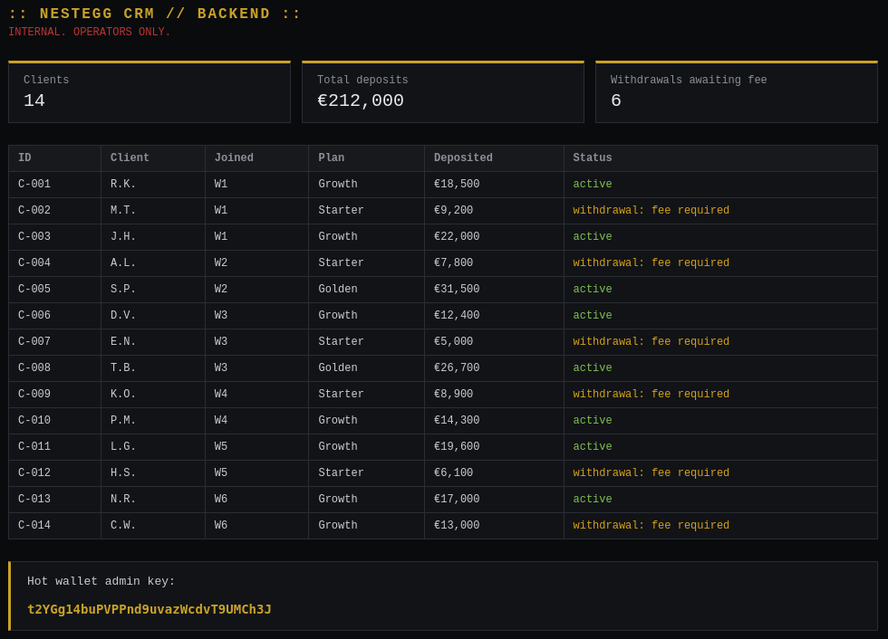

* TOC
{:toc}

## Onion Deanon 1: Read the Certificate

**Category**: OSINT

**Author**: [Covert Security](https://covsec.ee)

**Description**: 🧅 A hidden service hides where a server is, but only for as long as that server never says anything about itself anywhere else. ParsnipLocker is a ransomware crew that runs its leak blog as a Tor hidden service over HTTPS. Whether their anonymity investment holds up is for you to find out.

**Scope**: a simulated environment operated by Covert Security. Reach the onion service with Tor Browser. Stay passive — no port scan, brute force or probing. Only the single host you identify is in scope.  

Ransom note recovered from an infected workstation:  
```
=== YOUR NETWORK HAS BEEN PARSNIPPED ===
Hello, Globex Artisanal Mayonnaise Co.
Your files are encrypted. Your backups are gone.
You have 72 hours. Pay 0.8 XMR or we publish everything you own on our blog. Tor Browser required:
https://4uybrxybehxbf646wqbnyjxyjk2xis6mpvo4d57dv25zf5jsazf5tsad.onion
Case ID: PL-0091
- ParsnipLocker
```

**Task 1 — Read the Certificate**:   
Inspect the certificate presented by the ParsnipLocker leak blog.  
**Answer**: the certificate serial number, uppercase hexadecimal, no colons or spaces.  
Flag format: `CSCTF{<answer>}`

Going to `https://4uybrxybehxbf646wqbnyjxyjk2xis6mpvo4d57dv25zf5jsazf5tsad.onion`:



Looking at `about:certificate` for the site:
```shell
# Certificate

## Subject Name

Common Name 4uybrxybehxbf646wqbnyjxyjk2xis6mpvo4d57dv25zf5jsazf5tsad.onion

## Issuer Name

Common Name 4uybrxybehxbf646wqbnyjxyjk2xis6mpvo4d57dv25zf5jsazf5tsad.onion

## Validity

Not Before Wed, 21 Oct 2026 16:16:20 GMT Not After Sat, 18 Oct 2036 16:16:20 GMT

## Subject Alt Names

DNS Name 4uybrxybehxbf646wqbnyjxyjk2xis6mpvo4d57dv25zf5jsazf5tsad.onion

## Public Key Info

Algorithm RSA Key Size 2048 Exponent 65537 Modulus BA:BE:5A:90:65:37:8B:B1:73:2B:37:A1:E8:DD:48:45:24:56:E0:C8:A5:B8:B4:61:07:EE:08:F8:76:1A:18:90:33:AE:8D:24:3B:86:7E:91:BB:8B:80:8B:BD:33:E0:09:76:0D:76:09:33:E5:2B:A7:39:F4:85:6A:0F:8C:8D:AB:E1:68:4E:52:93:27:8E:70:BB:E9:79:AD:C7:F4:A1:CB:90:42:CD:73:C5:02:B1:4C:5E:1B:41:8C:42:31:E6:69:98:02:D3:1C:F4:2B:70:64:34:21:03:BF:CC:D4:8E:7B:AC:EE:E8:2A:5E:D3:0A:9E:19:26:84:F3:F7:FF:23:09:FB:DA:DD:C8:F9:5E:3D:9F:A5:36:E6:FC:6E:64:B1:EF:67:D9:C0:2E:F8:7B:EB:7C:0E:88:8D:A5:D6:C4:E7:69:FC:6F:5D:43:26:F7:4C:38:82:91:3B:4F:08:22:DA:39:CF:AB:34:46:74:CD:A6:3B:8A:67:B0:1F:FE:3A:56:25:28:50:91:DE:64:14:EB:1B:7C:5E:B7:C6:65:85:90:F0:9F:11:6A:DE:6A:DF:CC:D7:4B:BC:74:58:E3:B4:3E:AF:D0:45:12:52:1B:15:A3:45:7B:51:AF:EB:A7:DB:4B:FD:B8:49:9F:91:41:D4:81:47:34:9B:19:10:13:F3:E0:01

## Miscellaneous

Serial Number 6F:DB:E5:40:70:14:B7:6F:97:1F:AF:C7:E8:88:BD:66:FE:C5:D2:FD Signature Algorithm SHA-256 with RSA Encryption Version 3 Download PEM (cert)PEM (chain)

## Fingerprints

SHA-256 14:BF:CD:53:D5:09:FE:DF:0C:A4:FE:7E:9A:3D:6F:E2:A0:45:1F:4E:DA:F7:76:39:EB:BC:0F:ED:93:EB:23:80 

SHA-1 
C9:50:D9:28:97:49:37:D5:C4:E9:B0:F7:BF:B3:DD:47:16:16:8F:58 

## Basic Constraints

Certificate Authority Yes

## Subject Key ID

Key ID DA:33:82:2D:BC:8D:9A:C7:5A:3E:AE:3C:F4:C0:85:12:D4:4C:31:05

## Authority Key ID

Key ID DA:33:82:2D:BC:8D:9A:C7:5A:3E:AE:3C:F4:C0:85:12:D4:4C:31:05
```

`CSCTF{6FDBE5407014B76F971FAFC7E888BD66FEC5D2FD}`

___

## Onion Deanon 1: Fingerprint the Certificate

**Category**: OSINT

**Author**: [Covert Security](https://covsec.ee)

**Description**: *Continuation of the same lab. See the first task for the full briefing.*  

**Task 2 — Fingerprint the Certificate**:
Get the certificate's SHA-256 fingerprint.  
**Answer**: the SHA-256 fingerprint, uppercase hexadecimal with colons (e.g. `AA:BB:...`).  
Flag format: `CSCTF{}`

I have the cert info from task one already!
`CSCTF{14:BF:CD:53:D5:09:FE:DF:0C:A4:FE:7E:9A:3D:6F:E2:A0:45:1F:4E:DA:F7:76:39:EB:BC:0F:ED:93:EB:23:80}`

___

## Onion Deanon 1: Find the Origin

**Category**: OSINT

**Author**: [Covert Security](https://covsec.ee)

**Description**:*Continuation of the same lab. See the first task for the full briefing.*  

**Task 3 — Find the Origin**: 
Locate the real server hosting the ParsnipLocker leak blog.  
**Answer**: the clear-web IP address of that server.  
Flag format: `CSCTF{}`  
  
**Answer boundary:** Submit the one clear-web IPv4 address in this simulated lab that presents the same leaf certificate from Task 1. Do not submit an onion relay, DNS resolver, CDN address, historical certificate host, or a guessed address.

I went to [censys.io](censys.io) and searched for the sha-256 hash of the tls certificate. This reveals the servers real IP address and location:



```shell
curl -s -k --socks5-hostname 127.0.0.1:9150 https://4uybrxybehxbf646wqbnyjxyjk2xis6mpvo4d57dv25zf5jsazf5tsad.onion | grep -i "Leaked: "  
<div class="meta">Leaked: 14GB | Status: <span>PUBLISHED</span></div>  
<div class="meta">Leaked: 212GB | Status: <span>PUBLISHED</span></div>  
<div class="meta">Leaked: 38GB | Status: <span>PUBLISHED</span></div>  
<div class="meta">Leaked: 2GB Status: <span>PUBLISHED</span></div>
<div class="meta">Leaked: 61GB | Status: <span>PUBLISHED</span></div>

curl -s -k http://185.146.87.136/ | grep -i "Leaked: "
<div class="meta">Leaked: 14GB | Status: <span>PUBLISHED</span></div>  
<div class="meta">Leaked: 212GB | Status: <span>PUBLISHED</span></div>  
<div class="meta">Leaked: 38GB | Status: <span>PUBLISHED</span></div>  
<div class="meta">Leaked: 2GB Status: <span>PUBLISHED</span></div>
<div class="meta">Leaked: 61GB | Status: <span>PUBLISHED</span></div>
```

`CSCTF{185.146.87.136}`

___

## Onion Deanon 1: Find the Back Office

**Category**: OSINT

**Author**: [Covert Security](https://covsec.ee)

**Description**: *Continuation of the same lab. See the first task for the full briefing.*  

**Task 4 — Find the Back Office**:  
Find the operator's internal negotiation panel and retrieve its access token.  
**Answer**: the access token (UUID).  
Flag format: `CSCTF{}`  
  
**Answer boundary:** Use the unique origin established in Task 3. The UUID must be shown verbatim by the simulated negotiation panel; do not enumerate paths, use wordlists, or generate candidate tokens.

Censys reported 3 ports open. `22`, `443`, and `8080`. I navigated to `http://185.146.87.136:8080/` in my browser:



`CSCTF{db133256-5ed2-44bd-aaec-652a5213be0f}`

___

## Onion Deanon 2: Read the Favicon

**Category**: OSINT

**Author**: [Covert Security](https://covsec.ee)

**Description**: 🕊️ Even a server that only wants to be reached through Tor still tells the world a little about itself. DarkPigeon runs its victim negotiation portal as a Tor hidden service — onion routing only, no clearnet domain. Whether that is enough is for you to find out.  

**Scope**: simulated environment. Reach the onion service with Tor Browser. Stay passive. Only the single host you identify is in scope.  
**Forum post**:
```
[ DARKPIGEON ] NEW VICTIM: Coop & Crumb Birdseed Wholesalers
87 GB. Supplier contracts, customer database, payroll.
Victim portal (Tor Browser): http://schpqwdfzcmdcbim7w24jj5ph5h6fqvcbj5zhkhof3z3v75ydljkzsad.onion
```

**IR client email**:  
We've been hit by DarkPigeon and need to know where their portal is hosted so our lawyers can file a takedown. Please tell us what you find. > — Ottilie Crumb, IT Manager, Coop & Crumb  
**Task 1 — Read the Favicon**:
Obtain the favicon served by the DarkPigeon portal and hash it the way Shodan does.  
**Answer**: the favicon hash, as a signed integer.  
Flag format: `CSCTF{}`

I went to `http://schpqwdfzcmdcbim7w24jj5ph5h6fqvcbj5zhkhof3z3v75ydljkzsad.onion`:



I downloaded the favicon from `/favicon.ico`. 

I had to look up how Shodan hashes favicons. They do it like this:
```shell
python3  
Python 3.13.5 (main, Aug 10 2026, 12:06:59) [GCC 14.2.0] on linux  
Type "help", "copyright", "credits" or "license" for more information.  
    import mmh3  
    import base64  
    import codecs  
     
    with open("darkfavicon.ico", "rb") as f:  
        data = f.read()  
     
    b64 = base64.encodebytes(data)  
    hash_val = mmh3.hash(b64)  
    print(hash_val)  
     
-209798607
```

`CSCTF{-209798607}`

___

## Onion Deanon 2: Hash the Favicon Again

**Category**: OSINT

**Author**: [Covert Security](https://covsec.ee)

**Description**: *Continuation of the same lab. See the first task for the full briefing.*  

**Task 2 — Hash the Favicon Again**:  
Get the favicon's MD5 hash.  

**Answer**: the MD5 hash, hexadecimal.  
Flag format: `CSCTF{}`

`CSCTF{ad866421d43a616ab0e4dd089fc94b06}`

___

## Onion Deanon 2: Find the Origin

**Category**: OSINT

**Author**: [Covert Security](https://covsec.ee)

**Description**: *Continuation of the same lab. See the first task for the full briefing.*  

**Task 3 — Find the Origin**:  
Locate the real server hosting the DarkPigeon portal.  

**Answer**: the clear-web IP address of that server.  
Flag format: `CSCTF{}`  
  
**Answer boundary:** Submit the one clear-web IPv4 address in this simulated lab that serves the portal identified from the Task 1 favicon. Do not submit onion infrastructure, a relay, a historical host, or a guessed address.

On [censys.io](censys.io) I searched for `host.services.endpoints.http.html_title = "DarkPigeon | Negotiation Portal"`:



```shell
curl -s --socks5-hostname 127.0.0.1:9150 http://schpqwdfzcmdcbim7w24jj5ph5h6fqvcbj5zhkhof3z3v75ydljkzsad.onion/ | grep -i "<title>"  
<title>DarkPigeon | Negotiation Portal</title>

curl -s http://185.146.85.96/ | grep -i "<title>"  
<title>DarkPigeon | Negotiation Portal</title>  
```

`CSCTF{185.146.85.96}`

___

## Onion Deanon 2: Find the Back Office

**Category**: OSINT

**Author**: [Covert Security](https://covsec.ee)

**Description**: *Continuation of the same lab. See the first task for the full briefing.*  

**Task 4 — Find the Back Office**:
Find the operator's admin panel and retrieve the decryption key for the Coop & Crumb case. 

**Answer**: the decryption key (UUID).  
Flag format: `CSCTF{}`  
  
**Answer boundary:** Use the unique origin established in Task 3. The UUID must be shown verbatim by the simulated admin panel; do not enumerate paths, use wordlists, or generate candidate tokens.

Censys showed the ports `22`, `80`, and `8080` open. Looking at `http://185.146.85.96:8080/`:



Searching for Case ID `CC-0417` shows the fake threat actors talking about negotiations, and the victims decryption key (on `http://185.146.85.96:8080/ticket?case=CC-0417`):



`CSCTF{da4f9b9a-31c7-4b8f-91cb-1a5009d5f65b}`

___

## Cloudflare Deanon: Read the Platform

**Category**: OSINT

**Author**: [Covert Security](https://covsec.ee)

**Description**: 🪺 Putting a scam behind Cloudflare hides its address from victims, and from the investigators chasing it. NestEgg Capital promises guaranteed returns and delivers withdrawal fees. The site sits behind a proxy so nobody can see where it is hosted.  

**Scope**: simulated environment. Stay passive. Only the target domain and the single host you identify are in scope.  

**Internal fraud alert**:  
Over six weeks, 14 customers wired EUR 212,000 to NestEgg Capital. The cybercrime unit can only act on the hosting provider. The site sits behind Cloudflare. Find the real server. — Anneliese Brandt, Head of Fraud Intelligence, Marrowgate Savings Bank

**Call note 2291-07** (excerpt):  
Customer says the investment site is https://cs-adwi-covsec-lab-1.eu and that it is "licensed by the Lower Dunwich Financial Supervisory Board". Customer was told that withdrawals require a "small processing fee" and has now paid it four times.  

**Task 1 — Read the Platform**  
Find the company registration number advertised by the NestEgg Capital platform.  
**Answer**: the registration number.  
Flag format: `CSCTF{}`  
  
**Answer boundary:** Submit the registration number exactly as it is displayed by the simulated NestEgg public site. Do not substitute a registry lookup, a historical result, or a guessed value.

I went to `https://cs-adwi-covsec-lab-1.eu/` and found the registration number on the page:



`CSCTF{NEC-7731-0049}`

___

## Cloudflare Deanon: Find the Origin

**Category**: OSINT

**Author**: [Covert Security](https://covsec.ee)

**Description**: *Continuation of the same lab. See the first task for the full briefing.*  

**Task 2 — Find the Origin**:
Locate the real server hosting the NestEgg Capital platform. 

**Answer**: the clear-web IP address of that server.  
Flag format: `CSCTF{}`  
  
**Answer boundary:** Submit the one clear-web IPv4 origin in this simulated lab that serves the NestEgg site. Do not submit a Cloudflare edge, DNS resolver, historical address, or guessed address.

I went to censys and searched for `host.services.endpoints.http.html_title = "NestEgg Capital | Reg. No. NEC-7731-0049"`:



```shell
curl -s https://cs-adwi-covsec-lab-1.eu/ | grep -i "<title>"  
<title>NestEgg Capital | Reg. No. NEC-7731-0049</title>  

curl -s http://185.146.86.118/ | grep -i "<title>"  
<title>NestEgg Capital | Reg. No. NEC-7731-0049</title>
```
They are the same!

`CSCTF{185.146.86.118}`

___

## Cloudflare Deanon: Find the Back Office

**Category**: OSINT

**Author**: [Covert Security](https://covsec.ee)

**Description**: *Continuation of the same lab. See the first task for the full briefing.*  

**Task 3 — Find the Back Office**:  
Find the operator's backend panel and retrieve the hot wallet admin key. 

**Answer**: the admin key.  
Flag format: `CSCTF{}`  
  
**Answer boundary:** Use the unique origin established in Task 2. The admin key must be shown verbatim by the simulated backend panel; do not enumerate paths, use wordlists, or generate candidate keys.

On censys I saw ports `22`, `80`, and `8080` open. Looking at `http://185.146.86.118:8080/`:



`CSCTF{t2YGg14buPVPPnd9uvazWcdvT9UMCh3J}`

___

## Harvest

**Category**: OSINT

**Author**: [Kevin Sander](https://www.linkedin.com/in/kevin-sander-osint/)

**Description**: On 14 August 2026 at 19:42 MSK, a regional Telegram channel published a photo of a Mi-24 attack helicopter carrying a sling load over a wheat field, claiming that "bort 34" delivered cargo near the village of Staroselye that day.

The same evening, your monitoring cell obtained a set of files from the laptop of a logistics officer of the 417th Separate Helicopter Squadron (aerodrome KORLEVO), plus two encrypted reports intercepted on the squadron's radio net.

Everything you need is in the handout. Nothing here needs to be hacked, and no real person is involved.

**Where did the squadron's sling-load cargo actually go on 14 August, and what was it?**
Flag format: **`CSCTF{PP-N_CODEWORD}`**, for example **`CSCTF{PP-3_OVES}`**

I get the challenge files:
```shell
ls -la  
total 2092  
drwxrwxr-x 1 user user     314 Nov  7 19:32 .  
drwxrwxr-x 1 user user     292 Nov  7 19:31 ..  
-rw-rw-r-- 1 user user     798 Nov  7 19:31 00_brief.txt  
-rw-rw-r-- 1 user user     680 Nov  7 19:31 01_telegram_post.txt  
-rw-rw-r-- 1 user user 2115304 Nov  7 19:31 02_photo.png  
-rw-rw-r-- 1 user user    1226 Nov  7 19:31 03_flight_schedule_14AUG.txt  
-rw-rw-r-- 1 user user    1012 Nov  7 19:32 04_signals_instruction_extract.txt  
-rw-rw-r-- 1 user user     863 Nov  7 19:32 05_logistics_sheet_14AUG.txt  
-rw-rw-r-- 1 user user     449 Nov  7 19:32 06_intercepts_14AUG.txt
```

Looking at the challenge files:
```shell 
cat 01_telegram_post.txt  
Telegram — channel "Вести Пограничья" (Border News) — 52.4K subscribers  
14.08.2026, 19:42                                                  👁 48.2K  
  
⚡ЭКСКЛЮЗИВ. Кадры от нашего подписчика: Ми-24, борт 34, сегодня доставил  
груз у Староселья. Источник в эскадрилье подтверждает. Подробности скоро.  
#Староселье #борт34  
  
[attachment: 02_photo.png]  
  
--- auto-translation ---  
⚡EXCLUSIVE. Footage from one of our subscribers: Mi-24, bort 34, delivered  
cargo near Staroselye today. A source in the squadron confirms. More soon.

cat 03_flight_schedule_14AUG.txt  
ПЛАНОВАЯ ТАБЛИЦА ПОЛЁТОВ — FLIGHT SCHEDULE (extract, translated)  
417 OVE, aerodrome KORLEVO — 14.08.2026 — all times MSK  
  
BORT  TYPE        CALLSIGN  TASK                                   DEP-ARR      REMARKS  
----  ----------  --------  -------------------------------------  -----------  ------------------------------  
31    Mi-24P      KORSAR    Area reconnaissance, sector 3          06:10-07:40  -  
34    Mi-24P      VORON     -                                      -            U/S. Main gearbox replacement  
(гл. редуктор). Not before 18.08.  
/signed: eng. officer/  
37    Mi-24P      SOKOL     Escort for bort 22                     08:55-11:00  -  
21    Mi-8AMTSh   GRACH     Internal cargo, KORLEVO - LIPKI        07:30-09:05  -  
22    Mi-8MTV-5   ZHATVA    External sling load (внешняя подвеска) 09:00-10:55  LZ per separate order  
25    Mi-8MTV-5   BEREG     External sling load                    13:20-14:35  LZ PP-5  
  
NOTE: No flights after 15:00. Thunderstorm warning for the area from 15:00 until 22:00.

cat 04_signals_instruction_extract.txt
INSTRUCTION ON RADIO DISCIPLINE — 417 OVE — section 4 (extract, translated)

4.1  Crew reports are encrypted with the Vigenère table (Latin alphabet,
     transliterated Russian text, letters only). The letter X marks a word
     boundary. The key is the crews callsign for the day, as assigned in the
     flight schedule.
4.2  Message format:
       date-time group DDHHMM (MSK) / cipher text in groups of five letters /
       check group = total number of groups, two digits.
     The last group may be shorter than five letters.
4.3  Landing sites are referred to by PP number only.
     NAMING A SETTLEMENT IN A MESSAGE IS PROHIBITED.
4.4  Cargo is referred to by code word only (see logistics table).

4.5  Glossary
     DOKLAD report       GRUZ cargo         MESTO/MESTA/MEST piece(s)
     DOSTAVLEN delivered VREMYA time        BORT tail number     KONEC end
     ODIN 1  DVA 2  TRI 3  CHETYRE 4  PYAT 5  SHEST 6  SEM 7  VOSEM 8
     DEVYAT 9  DESYAT 10  SHESTNADTSAT 16  DVADTSAT 20  TRIDTSAT 30
     
cat 05_logistics_sheet_14AUG.txt
LOGISTICS — 417 OVE — working file (translated)

A) CARGO CODE WORDS (valid August)
   KORZINA  small-arms ammunition
   MESHOK   rations / drinking water
   SNOP     portable EW jamming set
   ZERNO    fuel bladders
   SENO     medical supplies
   OVES     spare parts

B) LOADING PLAN 14.08
   bort 21   OVES    x12   internal   -> LIPKI (aerodrome)
   bort 22   SNOP    x4    sling      -> PP per order
   bort 25   MESHOK  x6    sling      -> PP-5

C) LANDING SITES (PP)
   PP-1  Belaya Balka, meadow by the pond
   PP-2  Staroselye, pasture below the church    ** CLOSED since 02.08 — mines, see order 88 **
   PP-3  Lugovoe, former collective farm yard
   PP-4  Krasny Yar, gravel pit
   PP-5  Kurgany, beside the grain elevator
   PP-6  Dubki, forest clearing
   PP-7  Mirnoe, harvested field west of the dairy farm
   PP-8  Sosnovka, football pitch
   
cat 06_intercepts_14AUG.txt
INTERCEPT LOG — squadron net — 14.08.2026 — received times MSK

#1   received 10:21
     141020
     CVKEV DWGHT OVZEG KPZWZ NHKXB OEMTR DEMXN TZEDH NTZCL
     XIXOW XLZMW CRXHY ZEDXN YZAXW QACAS TOXAV RMSDU HDMNA
     SEDOV XJVNX X
     21

#2   received 16:34
     141630
     YCBZN YLMCE JBOUE PNOYB MNZBN SGYSF OLDSF OLUCF OOMZR
     ILGDK YJRLF OOICF ZZPSK QFVAL VLJVR NHEOQ OGRHK OFZRG
     NOKLO JFKLG MWUHF VHOQU ZHPFR SYFBR X
     24
```

They say the key for the vigenere cipher is the crews callsign from the flight schedule. There are only six callsigns given. 

The key for intercept 1 was `ZHATVA`.

The key for intercept 2 was `VORON`.

Decrypted 1:
```shell
DOKLAD ZHATVA GRUZ SNOP CHETYRE MESTA DOSTAVLEN PP SEM VREMYA DESYAT DVADTSAT BORT DVADTSAT DVA KONEC (the time is 10:20, bort 22)
```

Decrypted 2:
```shell
DOKLAD VORON GRUZ KORZINA SHEST MEST DOSTAVLEN PP DVA STAROSELYE VREMYA SHESTNADTSAT TRIDTSAT BORT TRIDTSAT CHETYRE KONEC (the time is 16:30, bort 34)
```

Figure out which one it was:

| Check               | #1 (bort 22)                    | #2 (bort 34)                                    |
| ------------------- | ------------------------------- | ----------------------------------------------- |
| Aircraft flying?    | Yes, sling load 09:00-10:55     | Grounded, gearbox replaced, not before 18.08    |
| Time plausible?     | 10:20, inside its flight window | 16:30, after the 15:00 flight ban for the storm |
| Cargo matches plan? | SNOP x4, as planned             | Not in the loading plan                         |
| Landing site valid? | PP-7 is open                    | PP-2 is closed because of mines                 |
| Rules followed?     | Uses a PP number only           | Names Staroselye, which is prohibited           |
| Check group         | 21 groups, correct              | Says 24, but 121 letters make 25 groups         |

`CSCTF{PP-7_SNOP}`
