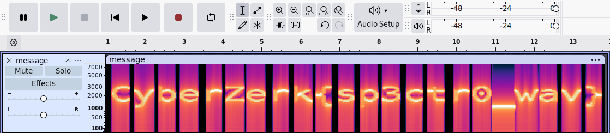

* TOC
{:toc}

## Access badge

**Category**: steganography

**Author**: Perceval

**Description**: The photo of Marc V.'s badge circulates on the intranet. The HR department uses it to justify that it "was present." What does this image really hide?

I get the challenge file:


```shell
python3  
Python 3.13.5 (main, Aug 10 2026, 12:06:59) [GCC 14.2.0] on linux  
Type "help", "copyright", "credits" or "license" for more information.  
>>> from PIL import Image  
... import numpy as np  
... im = np.array(Image.open('badge_marc_v.png').convert('RGB'))  
... bits = im[43, :320, 2] & 1  
... print(np.packbits(bits).tobytes())  
...  
b'CyberZerk{B4dg3_N0cturn3_H3ur3s_C4ch33s}'
```

`CyberZerk{B4dg3_N0cturn3_H3ur3s_C4ch33s}`

___

## Facade smile

**Category**: steganography

**Author**: Perceval

**Description**: HR has just released this motivational poster on the company’s network to “boost” developers before the big start-up.

But the graphic designer, on the edge of the abyss, discreetly concealed his true feeling.

Look beyond appearances.

There was a zip file in this image:
```shell
foremost motivation.png  
Processing: motivation.png  
|foundat=journal_intime.txtUT  
*|  

ls output/zip  
00000053.zip  

unzip output/zip/00000053.zip  
Archive:  output/zip/00000053.zip  
inflating: journal_intime.txt  

cat journal_intime.txt  
Je n'en peux plus. Ils nous font travailler tous les week-ends sans compensation. Voici la preuve de mon épuisement : CyberZerk{S0ur1r3_P0ur_C4ch3r_L3_Burn0ut}
```

`CyberZerk{S0ur1r3_P0ur_C4ch3r_L3_Burn0ut}`

___

## Trombinoscope

**Category**: steganography

**Author**: Perceval

**Description**: The photo of Marc V. at the HR trombinoscope looks commonplace. But a photo is never just an image: look at what it is lugging around with it. (file : trombi_marc_v.jpg)

The flag is in the metadata:
```shell
exiftool trombi_marc_v.jpg | grep 'Cyber'  
User Comment                    : CyberZerk{M3t4d0nn33s_EXIF_B4v4rd3s}
```

`CyberZerk{M3t4d0nn33s_EXIF_B4v4rd3s}`

___

## Double Background

**Category**: steganography

**Author**: Perceval

**Description**: A “crisis management” poster is circulating. She hides two things: a key, rows cleanly in the picture, and a message, stuck right after. One is used to read the other. (file : poster_crise.png)

There was an XOR key in the meta data:
```shell
exiftool affiche_crise.png  
ExifTool Version Number         : 13.25  
File Name                       : affiche_crise.png  
Directory                       : .  
File Size                       : 13 kB  
File Modification Date/Time     : 2026:11:10 19:21:02-05:00  
File Access Date/Time           : 2026:11:10 19:21:02-05:00  
File Inode Change Date/Time     : 2026:11:10 19:21:06-05:00  
File Permissions                : -rw-rw-r--  
File Type                       : PNG  
File Type Extension             : png  
MIME Type                       : image/png  
Image Width                     : 320  
Image Height                    : 200  
Bit Depth                       : 8  
Color Type                      : RGB  
Compression                     : Deflate/Inflate  
Filter                          : Adaptive  
Interlace                       : Noninterlaced  
Cle                             : Y3IxczMtdGMyNg==  
Warning                         : [minor] Trailer data after PNG IEND chunk  
Image Size                      : 320x200  
Megapixels                      : 0.064  

echo 'Y3IxczMtdGMyNg==' | base64 -d  
cr1s3-tc26
```

`exiftool` tells me there is trailing data:
```shell
xxd affiche_crise.png | tail  
00003290: 1530 0261 c2a0 0246 204c 98fa af42 af45  .0.a...F L...B.E  
000032a0: b704 2310 ef2a 583b daab d008 04e2 5d06  ..#..*X;......].  
000032b0: 1d42 2310 260c 2a60 04c2 8441 0ff8 4620  .B#.&.*`...A..F  
000032c0: 4c18 b407 4620 4c18 54c0 0884 0983 0a18  L...F L.T.......  
000032d0: 8130 6150 0123 1026 0c2a 6004 c284 4105  .0aP.#.&.*`...A.  
000032e0: 8c40 9830 a880 1108 13e6 ff01 4d99 d7b2  .@.0........M...  
000032f0: 87db 3d2b 0000 0000 4945 4e44 ae42 6082  ..=+....IEND.B`.  
00003300: 200b 5316 4177 1111 594d 3006 0214 0372   .S.Aw..YM0....r  
00003310: 2416 0345 3c2a 0121 6c6f 4550 5c69 2942  $..E<*.!loEP\i)B  
00003320: 4440 4e                                  D@N
```

XOR with the key `cr1s3-tc26`:
[cyberchef recipe](https://gchq.github.io/CyberChef/#recipe=From_Hex('Auto')XOR(%7B'option':'UTF8','string':'cr1s3-tc26'%7D,'Standard',false)&input=MjAwYjUzMTY0MTc3MTExMTU5NGQzMDA2MDIxNDAzNzIyNDE2MDM0NTNjMmEwMTIxNmM2ZjQ1NTA1YzY5Mjk0MjQ0NDA0ZQ&oeol=FF)

`CyberZerk{St3g0_Pu1s_X0R_B13n_J0u3}`

___

## Note of Costs

**Category**: cryptography

**Author**: Perceval

**Description**: The DAF encrypts its expense notes “so that no one puts their nose in it.” A burn-out trainee leaked this note before resigning. She would prove that the CODIR premiums exploded while the leave was denied.

I get the challenge file:
```shell
cat note_chiffree.txt  
SG1tZXREamZ2e1B0MXEzeF9RWkRLVl9VM2JvNG52X1AzeF9GM3F1dV9IM19IMGJyM3N9
```

base64 decode then vigenere decode with key `FOLACE`:
[cyberchef link](https://gchq.github.io/CyberChef/#recipe=From_Base64('A-Za-z0-9%2B/%3D',true,false)Vigen%C3%A8re_Decode('FOLACE')&input=U0cxdFpYUkVhbVoyZTFCME1YRXplRjlSV2tSTFZsOVZNMkp2Tkc1MlgxQXplRjlHTTNGMWRWOUlNMTlJTUdKeU0zTjk)

`CyberZerk{Pr1m3s_CODIR_P3nd4nt_L3s_R3fus_D3_C0ng3s}`

___

## The Inner Voice

**Category**: cryptography

**Author**: Perceval

**Description**: Excerpt from the analyst's logbook - Day 43.

"I can't move forward anymore. Every time I try to write this report, that voice in my head comes back. She blurs my thoughts, she encrypts my certainties. It constantly repeats the same thing to me, in a loop, as a fatality: I am bad.

I tried to write a note to reassure myself, to remember who I am. But the voice has taken over. My own message of hope was encrypted by his resen, using a centuries-old substitution method attributed to a 16th century French diplomat.

Here is the note I found this morning on my desk: `LctyzRrlv{Cy_Sm_Bs_Cflli_Awq}`

Vigenere decode with key `JESUISNUL` (french for "I'm useless"): [cyberchef link](https://gchq.github.io/CyberChef/#recipe=Vigen%C3%A8re_Decode('JESUISNUL')&input=TGN0eXpScmx2e0N5X1NtX0JzX0NmbGxpX0F3cX0)

`CyberZerk{Tu_As_Ta_Place_Ici}`

___

## HRD Mail

**Category**: forensics 

**Author**: Perceval

**Description**: We send you an internal email of the HRD, "authentic" according to him. Employees swear they never sent it. Prove where he really comes from and what he hides.

I get the challenge file:
```shell
cat note_du_drh.eml  
Return-Path: <attaquant@mail-cheap-relay.ru>  
Delivered-To: equipe@tricatel-cyber.fr  
Received: from vps-unknown.mail-cheap-relay.ru (vps-unknown.mail-cheap-relay.ru [45.83.12.207])  
	by mx.tricatel-cyber.fr (Postfix) with ESMTP id 9F2A1;  
	Fri, 13 Nov 2026 03:14:52 +0100 (CET)  
Received-SPF: fail (mx.tricatel-cyber.fr: domain of drh@tricatel-cyber.fr  
does not designate 45.83.12.207 as permitted sender)  
Authentication-Results: mx.tricatel-cyber.fr;  
	spf=fail smtp.mailfrom=attaquant@mail-cheap-relay.ru;  
	dkim=none; dmarc=fail (p=quarantine) header.from=tricatel-cyber.fr  
From: "Direction des Ressources Humaines" <drh@tricatel-cyber.fr>  
Reply-To: <attaquant@mail-cheap-relay.ru>  
To: <equipe@tricatel-cyber.fr>  
Subject: =?UTF-8?B?Tm90ZSBpbnRlcm5lIC0g4oCcYmllbnZlaWxsYW5jZeKAnQ==?=  
Date: Fri, 13 Nov 2026 03:14:49 +0100  
MIME-Version: 1.0  
Message-ID: <20261113031449.9F2A1@mail-cheap-relay.ru>  
Content-Type: multipart/mixed; boundary="=_cz_boundary_4726"  
  
--=_cz_boundary_4726  
Content-Type: text/plain; charset="UTF-8"  
Content-Transfer-Encoding: 7bit  
  
Bonjour a tous,  
  
Vous trouverez ci-joint la note interne de la Direction. Merci de la lire  
et de NE PAS la diffuser a l'exterieur. C'est pour votre bien.  
  
La DRH (enfin, c'est ce que pretend l'en-tete...)  
  
--=_cz_boundary_4726  
Content-Type: application/octet-stream; name="note_interne_rh.txt"  
Content-Transfer-Encoding: base64  
Content-Disposition: attachment; filename="note_interne_rh.txt"  
  
Tk9URSBJTlRFUk5FIC0gQ09ORklERU5USUVMIFJICk9iamV0IDogc3VydmVpbGxhbmNlIGRlcyBh  
cnJldHMgbWFsYWRpZQoKQ29uc2lnbmUgZGUgbGEgRGlyZWN0aW9uIDogY29udGVzdGVyIHN5c3Rl  
bWF0aXF1ZW1lbnQgbGVzIGFycmV0cwpkZSBwbHVzIGRlIDMgam91cnMgZXQgYmxvcXVlciBsZXMg  
YWNjZXMgaW5mb3JtYXRpcXVlcyBkdSBzYWxhcmllLgpOZSBwYXMgbGFpc3NlciBkZSB0cmFjZSBl  
Y3JpdGUgY290ZSBzYWxhcmllLgoKUHJldXZlIGRlIGwnb3JkcmUgOiBDeWJlclplcmt7TTRpbF9T  
cDAwZjNfUDB1cl9TdXJ2MzFsbDNyX0wzc19BcnIzdHN9Cg==  
  
--=_cz_boundary_4726--
```

Decode the attachment:
```shell
echo 'Tk9URSBJTlRFUk5FIC0gQ09ORklERU5USUVMIFJICk9iamV0IDogc3VydmVpbGxhbmNlIGRlcyBhcnJldHMgbWFsYWRpZQoKQ29uc2lnbmUgZGUgbGEgRGlyZWN0aW9uIDogY29udGVzdGVyIHN5c3RlbWF0aXF1ZW1lbnQgbGVzIGFycmV0cwpkZSBwbHVzIGRlIDMgam91cnMgZXQgYmxvcXVlciBsZXMgYWNjZXMgaW5mb3JtYXRpcXVlcyBkdSBzYWxhcmllLgpOZSBwYXMgbGFpc3NlciBkZSB0cmFjZSBlY3JpdGUgY290ZSBzYWxhcmllLgoKUHJldXZlIGRlIGwnb3JkcmUgOiBDeWJlclplcmt7TTRpbF9TcDAwZjNfUDB1cl9TdXJ2MzFsbDNyX0wzc19BcnIzdHN9Cg==' | base64 -d  
NOTE INTERNE - CONFIDENTIEL RH  
Objet : surveillance des arrets maladie  
  
Consigne de la Direction : contester systematiquement les arrets  
de plus de 3 jours et bloquer les acces informatiques du salarie.  
Ne pas laisser de trace ecrite cote salarie.  
  
Preuve de l'ordre : CyberZerk{M4il_Sp00f3_P0ur_Surv31ll3r_L3s_Arr3ts}
```

`CyberZerk{M4il_Sp00f3_P0ur_Surv31ll3r_L3s_Arr3ts}`

___

## Night of 13

**Category**: forensics 

**Author**: Perceval

**Description**: On the night of November 13, a confidential file left Tricatel's intranet. Here is the server access log. Find the successful exfiltration request. (file: access.log)

The flag was in plaintext in the log file (aside from the url encoded braces):
```shell
cat access.log | grep 'Cyber'  
45.83.12.207 - - [13/Nov/2026:02:47:03 +0100] "GET /export.php?file=rapport_confidentiel_rh.zip&token=CyberZerk%7BL0g_4n4lys3_Exf1l_C0nf1rm33%7D HTTP/1.1" 200 184320 "-" "curl /8.2.1"
```

`CyberZerk{L0g_4n4lys3_Exf1l_C0nf1rm33}`

___

## Calls for help

**Category**: forensics 

**Author**: Perceval

**Description**: A SOC analyst at Tricatel abruptly resigned yesterday. Before returning its hardware, the network team noticed a last suspicious request coming out of its station to an unidentified server. We have recovered a capture of its local network traffic. Analyze this capture to find his farewell message.

I get the challenge file:
```shell
file appels_a_l_aide.pcap  
appels_a_l_aide.pcap: pcap capture file, microsecond ts (little-endian) - version 2.4 (Ethernet, capture length 262144)
```

There was 12 packets in the capture. I followed the single http stream:
```shell
POST /adieu.php HTTP/1.1
Host: localhost:9999
Accept: */*
User-Agent: Mozilla/5.0 (Windows NT 10.0; Win64; x64) BurnoutBrowser/1.0
Content-Type: application/x-www-form-urlencoded
Content-Length: 198

employe=Marc_V&statut=epuisement_total&message=Je quitte Tricatel. Le management me détruit la santé mentale. Je n'ai plus dormi depuis 3 jours. Adieu. Flag: CyberZerk{Exf1ltr4t10n_HTTP_D3s3sp01r}
```

`CyberZerk{Exf1ltr4t10n_HTTP_D3s3sp01r}`

___

## Dump of Crisis

**Category**: forensics 

**Author**: Perceval

**Description**: Here is a copy of the Git deposit of the Tricatel intranet, retrieved before the departure of a dev. He vows to have “removed the secret from the code.” A secret removed from the code did not necessarily leave the story. (file : depot_intranet.tgz)

I get the challenge files:
```shell
ls -la  
total 8  
drwxr-xr-x 1 user user  44 Oct 24 12:02 .  
drwxrwxr-x 1 user user 820 Nov 10 20:00 ..  
-rw-r--r-- 1 user user  73 Oct 24 12:02 config.py  
-rw-r--r-- 1 user user 122 Oct 24 12:02 deploy.sh  
drwxr-xr-x 1 user user 144 Oct 24 12:02 .git
```

Looking at the git history:
```shell
git log  
commit db83693811815bef36166faf4d6585e25c0f1f83 (HEAD -> master)  
Author: IT Tricatel <it@tricatel.local>  
Date:   Sat Oct 24 18:02:12 2026 +0200  
  
	MAJ config  
  
commit b3fc79460448563cdfdc3440aff06d6ea8fffc6d  
Author: IT Tricatel <it@tricatel.local>  
Date:   Sat Oct 24 18:02:12 2026 +0200  
  
	Securisation: cle sortie du code (lue depuis env)  
  
commit 36e1d6e4796269f32a1aae755305771818af9ca3  
Author: IT Tricatel <it@tricatel.local>  
Date:   Sat Oct 24 18:02:12 2026 +0200  
  
	Ajout script de deploiement  
  
commit e04f0578e97436f02cf479e7262980dbb7707f18  
Author: IT Tricatel <it@tricatel.local>  
Date:   Sat Oct 24 18:02:12 2026 +0200  
  
	Init config intranet
```

```shell
git show 36e1d6e4796269f32a1aae755305771818af9ca3  
commit 36e1d6e4796269f32a1aae755305771818af9ca3  
Author: IT Tricatel <it@tricatel.local>  
Date:   Sat Oct 24 18:02:12 2026 +0200  
  
	Ajout script de deploiement  
  
diff --git a/deploy.sh b/deploy.sh  
new file mode 100644  
index 0000000..d21eace  
--- /dev/null  
+++ b/deploy.sh  
@@ -0,0 +1,4 @@  
+#!/bin/sh  
+# Script de déploiement - NE PAS COMMITER LES SECRETS  
+API_KEY="CyberZerk{G1t_N0ubl13_J4m41s_R13n_Du_P4ss3}"  
+echo "Déploiement avec $API_KEY"
```

`CyberZerk{G1t_N0ubl13_J4m41s_R13n_Du_P4ss3}`

___

## Ghost Journal

**Category**: forensics 

**Author**: Perceval

**Description**: Extract from the base of the pointer. A night score has been 'erased': the requests no longer show it. Find him.

I get the challenge file:
```shell
file pointeuse.sqlite  
pointeuse.sqlite: SQLite 3.x database, last written using SQLite version 3053001, file counter 3, database pages 2, cookie 0x1, schema 4, UTF-8, version-valid-for 3
```

Use `strings` to get the flag:
```shell
strings pointeuse.sqlite | grep Cyber  
i-ADMIN_SYSCyberZerk{sql1t3_d3l3t3_n3_v1d3_pas_l3s_p4g3s}2026-11-03 02:03
```

`CyberZerk{sql1t3_d3l3t3_n3_v1d3_pas_l3s_p4g3s}`

___

## Macro Inherited

**Category**: forensics 

**Author**: Perceval

**Description**: Macro extracted from the HRD suspect workbook. What does it reveal at the opening?

I get the challenge file:
```shell
file macro.vba  
macro.vba: Unicode text, UTF-8 text, with very long lines (749)
```

```shell
cat macro.vba
Attribute VB_Name = "Module1"
' Macro héritée du classeur de suivi des congés (Tricatel)
Private Sub Workbook_Open()
    Dim s As String
    s = Chr(102) & Chr(84) & Chr(78) & Chr(122) & Chr(99) & Chr(106) & Chr(78) & Chr(50) & Chr(77) & Chr(51) & Chr(74) & Chr(102) & Chr(78) & Chr(68) & Chr(90) & Chr(105) & Chr(88) & Chr(51) & Chr(74) & Chr(111) & Chr(89) & Chr(49) & Chr(56) & Chr(122) & Chr(98) & Chr(109) & Chr(107) & Chr(48) & Chr(97) & Chr(71) & Chr(78) & Chr(102) & Chr(98) & Chr(106) & Chr(65) & Chr(120) & Chr(100) & Chr(68) & Chr(82) & Chr(106) & Chr(99) & Chr(51) & Chr(86) & Chr(109) & Chr(89) & Chr(106) & Chr(66) & Chr(122) & Chr(77) & Chr(50) & Chr(82) & Chr(102) & Chr(89) & Chr(87) & Chr(74) & Chr(50) & Chr(101) & Chr(50) & Chr(116) & Chr(121) & Chr(90) & Chr(86) & Chr(112) & Chr(121) & Chr(90) & Chr(87) & Chr(74) & Chr(53) & Chr(81) & Chr(119) & Chr(61) & Chr(61)
    ' s contient une chaîne encodée ; decodee puis inversee a l'execution
    Dim raw As String
    raw = DecodeBase64(s)
    MsgBox StrReverse(raw)
End Sub

Private Function DecodeBase64(ByVal b64 As String) As String
    Dim xml As Object, node As Object
    Set xml = CreateObject("MSXML2.DOMDocument.3.0")
    Set node = xml.createElement("b64")
    node.DataType = "bin.base64"
    node.Text = b64
    DecodeBase64 = StrConv(node.nodeTypedValue, vbUnicode)
End Function
```

Taking just the numbers from `s`, I did the cyberchef recipe `from decimal`, then `from base64`, the `reverse` to get the flag.

`CyberZerk{vba_d3s0bfusc4t10n_ch4in3_chr_b64_r3v3rs3}`

___

## Caught Strikes

**Category**: forensics 

**Author**: Perceval

**Description**: USB capture of a keyboard plugged into a station. Replenish what was typed.

I get the challenge file:
```shell
file frappes.pcap  
frappes.pcap: pcap capture file, microsecond ts (little-endian) - version 2.4 (Memory-mapped Linux USB, capture length 65535)
```

Looking at the USB packets:
```shell
tshark -r frappes.pcap -Y 'usb.capdata && usb.data_len == 8' -T fields -e usb.capdata | head  
0200060000000000  
0000000000000000  
00001c0000000000  
0000000000000000  
0000050000000000  
0000000000000000  
0000080000000000  
0000000000000000  
0000150000000000  
0000000000000000
```

Each line is an 8 byte USB HID keyboard report. Byte 0 = modifier keys. `0x02` = Left Shift. Byte 2 = keycode. All zero lines are key release reports.

This script will decode each line:
```python
import sys

hid = {
    0x04: 'a', 0x05: 'b', 0x06: 'c', 0x07: 'd', 0x08: 'e',
    0x09: 'f', 0x0a: 'g', 0x0b: 'h', 0x0c: 'i', 0x0d: 'j',
    0x0e: 'k', 0x0f: 'l', 0x10: 'm', 0x11: 'n', 0x12: 'o',
    0x13: 'p', 0x14: 'q', 0x15: 'r', 0x16: 's', 0x17: 't',
    0x18: 'u', 0x19: 'v', 0x1a: 'w', 0x1b: 'x', 0x1c: 'y',
    0x1d: 'z', 0x1e: '1', 0x1f: '2', 0x20: '3', 0x21: '4', 
    0x22: '5', 0x23: '6', 0x24: '7', 0x25: '8', 0x26: '9', 
    0x27: '0', 0x28: '\n', 0x2c: ' ', 0x2d: '-', 0x2e: '=', 
    0x2f: '[', 0x30: ']', 0x31: '\\', 0x32: ';', 0x33: "'", 
    0x34: '`', 0x35: ',', 0x36: '.', 0x37: '/',
}

shift_map = {
    '1': '!', '2': '@', '3': '#', '4': '$', '5': '%',
    '6': '^', '7': '&', '8': '*', '9': '(', '0': ')',
    '-': '_', '=': '+', '[': '{', ']': '}', '\\': '|',
    ';': ':', "'": '"', '`': '~', ',': '<', '.': '>', '/': '?',
}

out = []

for line in sys.stdin:
    line = line.strip()
    if not line:
        continue

    b = bytes.fromhex(line)
    if len(b) != 8:
        continue

    mod = b[0]
    key = b[2]

    if key == 0:
        continue

    if key == 0x2a:
        if out:
            out.pop()
        continue

    ch = hid.get(key)
    if ch is None:
        continue

    shifted = bool(mod & 0x02 or mod & 0x20)

    if shifted:
        ch = shift_map.get(ch, ch.upper())

    out.append(ch)

print(''.join(out))
```

```shell
tshark -r frappes.pcap -Y 'usb.capdata && usb.data_len == 8' -T fields -e usb.capdata | python3 decode_usb.py  
CyberZerk{usb_h1d_k3yb0ard_r3p0rt_8_0ct3ts}
```

`CyberZerk{usb_h1d_k3yb0ard_r3p0rt_8_0ct3ts}`

___

## Fragments

**Category**: forensics 

**Author**: Perceval

**Description**: Gross fragment of the unallocated space of a disk, without a file table. Find and extract what is hidden there.

I get the challenge file:
```shell
file secteur.raw  
secteur.raw: data
```

I ran `foremost` on the file and found an image:
```shell
foremost secteur.raw  
Processing: secteur.raw  
|*|  

ls output/png  
00000009.png  

file output/png/00000009.png  
output/png/00000009.png: PNG image data, 64 x 64, 8-bit/color RGB, non-interlaced
```

The flag was in the metadata:
```shell
exiftool output/png/00000009.png  
ExifTool Version Number         : 13.25  
File Name                       : 00000009.png  
Directory                       : output/png  
File Size                       : 289 bytes  
File Modification Date/Time     : 2026:11:17 21:03:48-05:00  
File Access Date/Time           : 2026:11:17 21:03:48-05:00  
File Inode Change Date/Time     : 2026:11:17 21:03:48-05:00  
File Permissions                : -rw-rw-r--  
File Type                       : PNG  
File Type Extension             : png  
MIME Type                       : image/png  
Image Width                     : 64  
Image Height                    : 64  
Bit Depth                       : 8  
Color Type                      : RGB  
Compression                     : Deflate/Inflate  
Filter                          : Adaptive  
Interlace                       : Noninterlaced  
Commentaire                     : Capture interne — ne pas diffuser  
Flag                            : CyberZerk{c4rv1ng_l3_PNG_surv1t_a_l_3ff4c3m3nt}  
Image Size                      : 64x64  
Megapixels                      : 0.004
```

`CyberZerk{c4rv1ng_l3_PNG_surv1t_a_l_3ff4c3m3nt}`

___

## Discreet Tunnel

**Category**: forensics 

**Author**: Perceval

**Description**: Network capture of a station. A process speaks a lot to the DNS. What's he getting out?

I get the challenge file and look at dns queries:
```shell
file capture.pcap  
capture.pcap: pcap capture file, microsecond ts (little-endian) - version 2.4 (Ethernet, capture length 65535)  

tshark -r capture.pcap -Y "dns.qry.name" -T fields -e dns.qry.name -e dns.qry.type  
00.43796265725a.exfil-4167c682.tricatel-interne.fr      1  
01.65726b7b646e.exfil-4167c682.tricatel-interne.fr      1  
02.735f33786631.exfil-4167c682.tricatel-interne.fr      1  
03.6c7472347431.exfil-4167c682.tricatel-interne.fr      1  
04.306e5f723334.exfil-4167c682.tricatel-interne.fr      1  
05.7373336d626c.exfil-4167c682.tricatel-interne.fr      1  
06.335f6c33735f.exfil-4167c682.tricatel-interne.fr      1  
07.733075735f64.exfil-4167c682.tricatel-interne.fr      1  
08.306d34316e33.exfil-4167c682.tricatel-interne.fr      1  
09.737d.exfil-4167c682.tricatel-interne.fr      1  
intranet.tricatel-interne.fr    1  
mail.tricatel-interne.fr        1  
wiki.tricatel-interne.fr        1  
proxy.tricatel-interne.fr       1
```

The flag was hex encoded:
```shell
echo '43796265725a65726b7b646e735f337866316c7472347431306e5f7233347373336d626c335f6c33735f733075735f64306d34316e33737d' | xxd -r -p  
CyberZerk{dns_3xf1ltr4t10n_r34ss3mbl3_l3s_s0us_d0m41n3s}
```

`CyberZerk{dns_3xf1ltr4t10n_r34ss3mbl3_l3s_s0us_d0m41n3s}`

___

## Hidden Frequency

**Category**: steganography

**Author**: Perceval

**Description**: Recording left on internal messaging. The ear hears nothing but a sound... but the eye?

I get the challenge file:
```shell
file message.wav  
message.wav: RIFF (little-endian) data, WAVE audio, Microsoft PCM, 16 bit, mono 16000 Hz
```

I opened the file in audacity and looked at the spectrogram view:



`CyberZerk{sp3ctr0_wav}`
