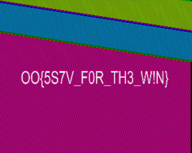
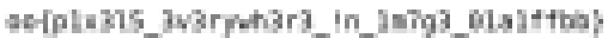
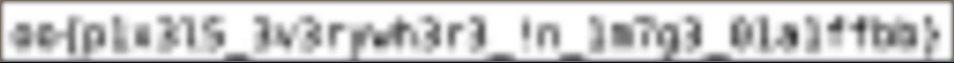
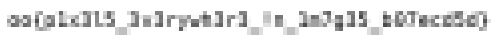
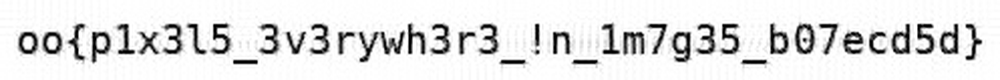

* TOC
{:toc}

## DisgruntledDev I

**Category**: forensics

**Author**: digitalsurf

**Description**: Our SOC received an alert about anomalous outbound traffic originating from developer Marcus Chen's workstation (`192.168.1.47`) at Initech Corp. Marcus put in his two weeks' notice yesterday and HR is concerned he may be taking company IP with him.

We've pulled a packet capture from the network tap. Analyze the traffic and determine if Marcus exfiltrated any data. Find the flag hidden in the stolen goods.

I get the challenge file:
```shell
file dd1_easy.pcap  
dd1_easy.pcap: pcap capture file, microsecond ts (little-endian) - version 2.4 (Raw IPv4, capture length 65535)
```

I searched for `ip.addr == 192.168.1.47` in wireshark. I see he logged into a personal FTP server with `mchen_personal:Summer2023!` and transferred a file called `proprietary_algorithm_v3.tar.gz`:
```shell
#############################################
# INITECH PROPRIETARY - DO NOT DISTRIBUTE   #
# Project Falcon - Core Algorithm v3.2      #
# Classification: CONFIDENTIAL              #
#############################################

// Authentication token for staging environment
// OO{ftp_1s_n3v3r_s4f3}

def falcon_core(input_matrix, weights):
    transformed = apply_proprietary_transform(input_matrix)
    result = numpy.dot(transformed, weights)
    return optimize_output(result, threshold=0.85)

# END OF FILE
```

`OO{ftp_1s_n3v3r_s4f3}`

___

## DisgruntledDev II

**Category**: forensics

**Author**: digitalsurf

**Description**: Our favorite dev Marcus is at it again. After the FTP incident, IT locked down outbound file transfers from his workstation (`192.168.1.47`). But the SOC is still seeing unusual network patterns in his traffic — something that blends in with normal DNS activity but doesn't quite fit.

We suspect he's found a subtler way to smuggle data out. Analyze this capture and find what he's hiding.

I get the challenge file:
```shell
file dd2_medium.pcap  
dd2_medium.pcap: pcap capture file, microsecond ts (little-endian) - version 2.4 (Raw IPv4, capture length 65535)
```

I wireshark I searched for `ip.addr == 192.168.1.47 && dns.qry.type == 16`. I found the flag base32 encoded. [cyberchef recipe](https://gchq.github.io/CyberChef/#recipe=From_Base32('A-Z2-7%3D',true)&input=SjVIWFdaRE9PTlBYSTVMT05ZWldZWDNNR0ZWVEdYWlVMNVlIRU1ENQ)

`OO{dns_tunn3l_l1k3_4_pr0}`

___

## DisgruntledDev III

**Category**: forensics

**Author**: digitalsurf

**Description**: Marcus is getting smarter....

After we caught his FTP upload and DNS tunnel, he's moved to something more sophisticated. Our IDS didn't flag anything obvious this time, no known tunnel signatures, no plaintext protocols, no suspicious domains.

I've been keeping a close eye on him and noticed two things: Marcus's workstation (`192.168.1.47`) is generating ICMP traffic to an IP that isn't the gateway, and he made an HTTP POST to an external paste service during the same window. I don't think these are coincidental.

Go check it out.

I get the challenge file:
```shell
file dd3_hard.pcap  
dd3_hard.pcap: pcap capture file, microsecond ts (little-endian) - version 2.4 (Raw IPv4, capture length 65535)
```

I found this POST request:
```shell
POST /api/paste HTTP/1.1
Host: paste.hackmd.io
User-Agent: Mozilla/5.0 (X11; Linux x86_64; rv:109.0) Gecko/20100101 Firefox/119.0
Content-Type: application/x-www-form-urlencoded
Cookie: _ga=GA1.2.64336164626565663432.1700000000; _session=eyJhbGciOiJIUzI1NiJ9; _csrf=random_token_here
Content-Length: 226

title=Useful bash snippets&content=Here are some useful commands for daily work

1. find . -name "*.log" -mtime +7 -delete
2. grep -rn "TODO" .
3. docker system prune -af
4. git log --oneline -20&visibility=privateHTTP/1.1 201 Created
Content-Type: application/json
Content-Length: 48

{"id":"abc123","url":"https://paste.hackmd.io/ab
```

The cookie contained an XOR key:
```shell
echo '64336164626565663432' | xxd -r -p  
d3adbeef42
```

I found this data from ICMP packets:
```shell
tshark -r dd3_hard.pcap -Y "ip.src == 192.168.1.47 && icmp.type == 8" -T fields -e data.data | grep '41d954fd08'  
41d954fd080000002b7c1a5501081539  
41d954fd080666665702120013103d06  
41d954fd080ccccd0d525a5c575f3e1c  
41d954fd081333330d173a0b00411000  
41d954fd0819999a1319000000000000
```

After stripping the 8 byte header, XOR and get the flag:
```python
python3  
Python 3.13.5 (main, Aug 10 2026, 12:06:59) [GCC 14.2.0] on linux  
Type "help", "copyright", "credits" or "license" for more information.  
>>> data = bytes.fromhex(  
...     "2b7c1a5501081539"  
...     "5702120013103d06"  
...     "0d525a5c575f3e1c"  
...     "0d173a0b00411000"  
...     "1319000000000000"  
... )  
... key = b"d3adbeef42"  
... print(bytes(b ^ key[i % len(key)] for i, b in enumerate(data)).decode())  
...  
OO{1cmp_c0v3rt_ch4nn3l_xor_m4st3r}beef42
```

`OO{1cmp_c0v3rt_ch4nn3l_xor_m4st3r}`

___

## Hidden In The Streams

**Category**: forensics

**Author**: quut

**Description**: The sysadmin found this cool-looking audio in the disk backup, what does it mean?

I get the challenge file:
```shell
file backup.dd  
backup.dd: DOS/MBR boot sector, code offset 0x52+2, OEM-ID "NTFS    ", sectors/cluster 8, Media descriptor 0xf8, sectors/track 0, dos < 4.0 BootSector (0x80), FAT (1Y bit by descriptor); NTFS, sectors 40959, $MFT start cluster 4, $MFTMirror start cluster 2559, bytes/RecordSegment 2^(-1*246), clusters/index block 1, serial number 017014c0366a6cf1e
```

I looked for deleted files and got a decoy flag:
```shell
fls -r -d backup.dd  
-/r * 64-128-2: flag.txt  
-/r * 64-128-10:        flag.txt:0  
-/r * 64-128-11:        flag.txt:1  
-/r * 64-128-12:        flag.txt:2  
-/r * 64-128-13:        flag.txt:3  
-/r * 64-128-14:        flag.txt:4  
-/r * 72-128-2: normalfile.txt  
-/r * 16:       $OrphanFiles/OrphanFile-16  
-/r * 17:       $OrphanFiles/OrphanFile-17  
-/r * 18:       $OrphanFiles/OrphanFile-18  
-/r * 19:       $OrphanFiles/OrphanFile-19  
-/r * 20:       $OrphanFiles/OrphanFile-20  
-/r * 21:       $OrphanFiles/OrphanFile-21  
-/r * 22:       $OrphanFiles/OrphanFile-22  
-/r * 23:       $OrphanFiles/OrphanFile-23

icat backup.dd 64-128-10 > flag  

cat flag  
T097SDFE

icat backup.dd 64-128-11 > flag2  

cat flag2  
ZDNuXyFu

icat backup.dd 64-128-12 > flag3  

cat flag3  
XzdoM181

icat backup.dd 64-128-13 > flag4  

cat flag4  
N3IzQG01

icat backup.dd 64-128-14 > flag5  

cat flag5  
ITF9

echo 'T097SDFEZDNuXyFuXzdoM181N3IzQG01ITF9' | base64 -d  
OO{H1Dd3n_!n_7h3_57r3@m5!1}
```

Looking at the full filesystem I found an audio file:
```shell
fls -r -p backup.dd  
r/r 4-128-1:    $AttrDef  
r/r 8-128-2:    $BadClus  
r/r 8-128-1:    $BadClus:$Bad  
r/r 6-128-1:    $Bitmap  
r/r 7-128-1:    $Boot  
d/d 11-144-2:   $Extend  
r/r 25-144-2:   $Extend/$ObjId:$O  
r/r 24-144-3:   $Extend/$Quota:$O  
r/r 24-144-2:   $Extend/$Quota:$Q  
r/r 26-144-2:   $Extend/$Reparse:$R  
r/r 2-128-1:    $LogFile  
r/r 0-128-1:    $MFT  
r/r 1-128-1:    $MFTMirr  
r/r 9-128-2:    $Secure:$SDS  
r/r 9-144-3:    $Secure:$SDH  
r/r 9-144-4:    $Secure:$SII  
r/r 10-128-1:   $UpCase  
r/r 10-128-2:   $UpCase:$Info  
r/r 3-128-3:    $Volume  
r/r 65-128-2:   flag.wav  
r/r 65-128-4:   flag.wav:part0  
r/r 65-128-5:   flag.wav:part1  
r/r 65-128-6:   flag.wav:part2  
r/r 65-128-7:   flag.wav:part3  
r/r 65-128-8:   flag.wav:part4  
-/r * 64-128-2: flag.txt  
-/r * 64-128-10:        flag.txt:0  
-/r * 64-128-11:        flag.txt:1  
-/r * 64-128-12:        flag.txt:2  
-/r * 64-128-13:        flag.txt:3  
-/r * 64-128-14:        flag.txt:4  
-/r * 72-128-2: normalfile.txt  
V/V 73: $OrphanFiles  
-/r * 16:       $OrphanFiles/OrphanFile-16  
-/r * 17:       $OrphanFiles/OrphanFile-17  
-/r * 18:       $OrphanFiles/OrphanFile-18  
-/r * 19:       $OrphanFiles/OrphanFile-19  
-/r * 20:       $OrphanFiles/OrphanFile-20  
-/r * 21:       $OrphanFiles/OrphanFile-21  
-/r * 22:       $OrphanFiles/OrphanFile-22  
-/r * 23:       $OrphanFiles/OrphanFile-23  

icat backup.dd 65-128-2 > flag.wav
```

I went to [https://sstv-decoder.mathieurenaud.fr/](https://sstv-decoder.mathieurenaud.fr/) and decoded the audio into an image:



`OO{5S7V_F0R_TH3_W!N}`

___

## The Flag I

**Category**: forensics

**Description**: This image has been blurred beyond recognition.

Recover the hidden flag.

I get the challenge image:



I put the image into [https://stitchee.ca/pixelator](https://stitchee.ca/pixelator) and tested the de-pixelate feature. I got this image:



This was enough to read it. I got a lot of failed guesses but eventually got it!

`oo{p1x3l5_3v3rywh3r3_!n_1m7g3_01a1ffbb}`

___

## The Flag II

**Category**: forensics

**Description**: One pixelated image is not enough to reveal the whole picture.

Combine the supplied copies to recover the hidden flag. 

I get the challenge files:
```shell
unzip out.zip  
Archive:  out.zip  
   creating: out/  
  inflating: out/copy_00.png  
  inflating: out/copy_01.png  
 extracting: out/copy_02.png  
 extracting: out/copy_03.png  
  inflating: out/copy_04.png  
 extracting: out/copy_05.png  
  inflating: out/copy_06.png  
  inflating: out/copy_07.png  
 extracting: out/copy_08.png  
 extracting: out/copy_09.png  
  inflating: out/shifts.json
```

The images are all blurred slightly differently:





Contents of `shifts.json`:
```json
{
  "block": 4,
  "size": [
    497,
    40
  ]
}
```

Each copy is the same image pixelated with a different grid offset so every copy samples slightly different pixels. The 4 in `shifts.json` is the block size. Each image has a different grid offset. 

I ran this script which estimates each offset from the block edges and uses iterative back projection to reconstruct a high resolution image consistent with all ten pixelated versions:
```python
import numpy as np, glob
from PIL import Image

files = sorted(glob.glob("copy_*.png"))
imgs = [np.asarray(Image.open(f).convert("L"), float) for f in files]
H, W = imgs[0].shape
B = 4

def phase(a, axis):
    # block edges show up as jumps. find which column they sit on
    d = np.abs(np.diff(a, axis=axis)).sum(axis=1 - axis)
    r = max(range(B), key=lambda r: d[r::B].sum())
    return (r + 1) % B  # first full block starts here

def avg_matrix(n, s):
    g = (np.arange(n) - s) // B
    g -= g.min()
    A = np.zeros((g.max() + 1, n)); A[g, np.arange(n)] = 1
    return A / A.sum(1, keepdims=True), g

ops = []
for f, a in zip(files, imgs):
    sy, sx = phase(a, 0), phase(a, 1)
    print(f, "phase (y,x):", sy, sx)
    Ay, gy = avg_matrix(H, sy); Ax, gx = avg_matrix(W, sx)
    ops.append((a, Ay, Ax, gy, gx))

# iterative back projection: make the estimate consistent with every copy
est = np.mean(imgs, axis=0)
for it in range(200):
    for a, Ay, Ax, gy, gx in ops:
        low = Ay @ est @ Ax.T      # repixelate estimate with this copys grid
        est += a - low[gy][:, gx]  # push the residual back

est = np.clip(est, 0, 255)
lo, hi = np.percentile(est, (1, 99))
out = np.clip((est - lo) / (hi - lo), 0, 1) * 255
Image.fromarray(out.astype(np.uint8)).resize((W * 3, H * 3), Image.LANCZOS).save("recovered.png")
```

The iterative back projection works like this: 

Start with a guess (the average of all copies). Then repeat:
- Pixelate the current guess using copy `k`s grid.
- Compare it to the real copy `k`. The difference is the error.
- Add that error back onto the guess, spread across the pixels that made up each block.
Cycling through all 10 copies for 200 rounds makes the guess consistent with every copy at once.

`recovered.png`:



`oo{p1x3l5_3v3rywh3r3_!n_1m7g35_b07ecd5d}`
