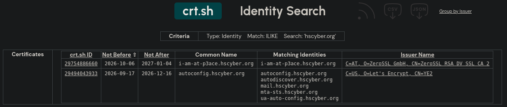
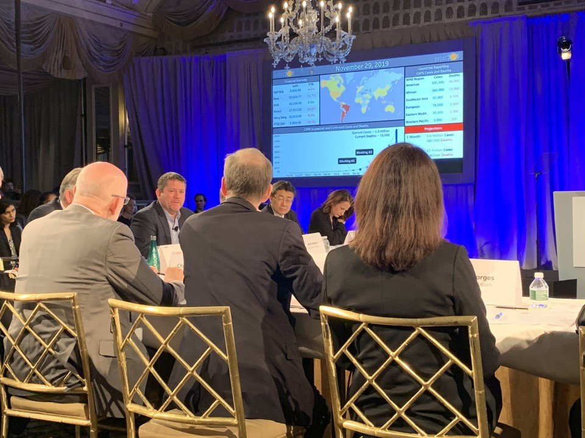
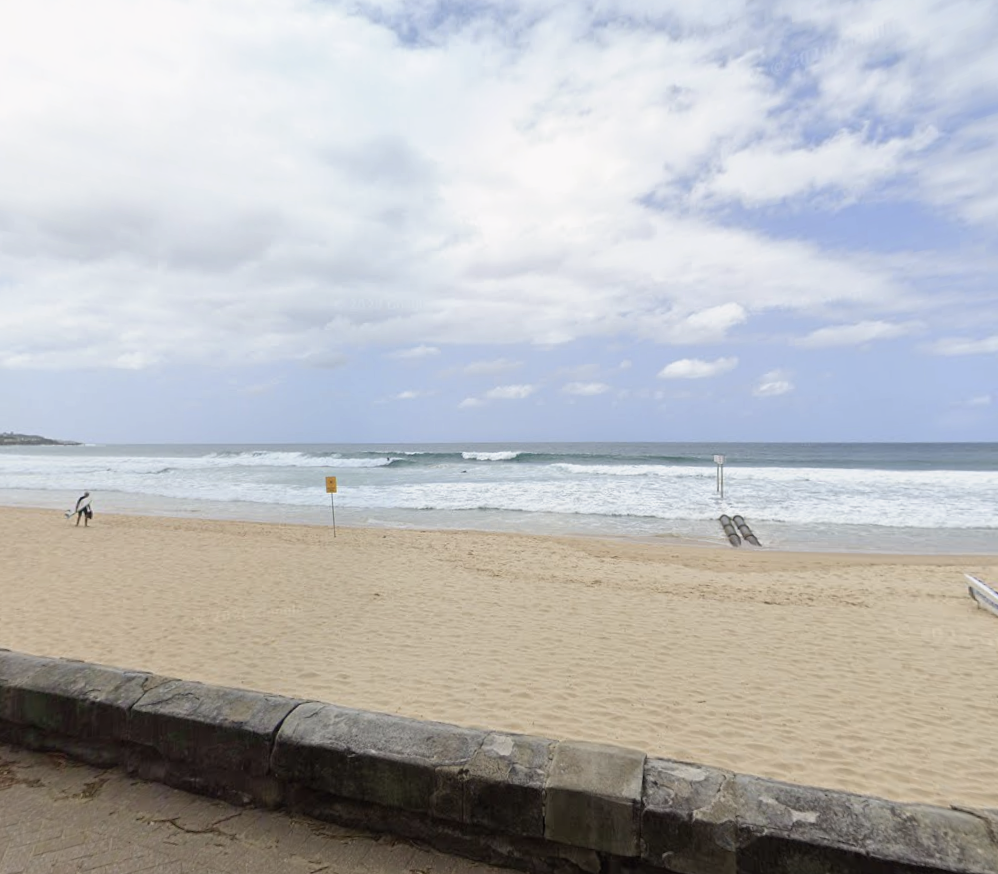

* TOC
{:toc}

## CERT UP

**Category**: osint

**Author**: digitalsurf

**Description**: To be at peace, one needs to be transparent.

Flag format: `OO{...}`

I visited `https://crt.sh/?q=hscyber.org`:



`OO{i-am-at-p3ace}`

___

## Conspiracy Theory

**Category**: osint

**Author**: max

**Description**: You are given a photograph from a conference event. Your task is to find the names of three specific attendees visible in the scene and use their first and last names to construct the flag.

Flag format: `OO{attendee_left_attendee_middle_attendee_right}`

Each attendee is `Firstname_Lastname`

I get the challenge image:



I reverse image search the image and find [https://centerforhealthsecurity.org/our-work/tabletop-exercises/event-201-pandemic-tabletop-exercise](https://centerforhealthsecurity.org/our-work/tabletop-exercises/event-201-pandemic-tabletop-exercise). They explain the event:
```shell
Event 201

This training tabletop exercise is based on a fictional scenario. 
The inputs experts used for modeling the potential impact were fictional. 
It is a teaching and training resource for public health and government officials.
```

I found a different angle of the room on this day:


Their names are listed in front of them.

`OO{Chris_Elias_Tom_Inglesby_Sofia_Borges}`

___

## Git Blame I

**Category**: osint

**Author**: digitalsurf

**Description**: Remember OutbackCorp's URL health checker, the one you've been tearing apart in Fetch Quest? Turns out it's open source: **github.com/outbackcorp-it**

Every commit is signed off by "Jake M.", the IT intern who built it. Jake keeps his work and personal life separate. Or so he thinks.

Find Jake's personal GitHub account.

Flag format: `OO{...}`

I clone the repo and find an email:
```shell
git clone https://github.com/outbackcorp-it/url-checker.git  
Cloning into 'url-checker'...  
remote: Enumerating objects: 20, done.  
remote: Counting objects: 100% (20/20), done.  
remote: Compressing objects: 100% (11/11), done.  
remote: Total 20 (delta 3), reused 19 (delta 2), pack-reused 0 (from 0)  
Receiving objects: 100% (20/20), done.  
Resolving deltas: 100% (3/3), done.  

cd url-checker  

git log  
commit 4e0555adc73eeeefe338d8dac8dfbcbbe0ded345 (HEAD -> main, origin/main, origin/HEAD)  
Author: Jake M. <jakeyb0i-qld.dev@example.com>  
Date:   Thu Sep 10 14:05:00 2026 +1000  
  
	bump timeout
	
... etc ...
```

I found the flag here: [https://github.com/jakeyb0i-qld/jakeyb0i-qld/commit/acea35d156193479431bea814bf40dc6bd1680d4](https://github.com/jakeyb0i-qld/jakeyb0i-qld/commit/acea35d156193479431bea814bf40dc6bd1680d4)

`OO{p4tch_f1l3s_t3ll_t4l3s}`

___

## Git Blame II

**Category**: osint

**Author**: digitalsurf

**Description**: Now that you've found Jake's personal account, have a look at what he's been building at home.

He says he "cleaned up" before making anything public. We've all heard that one before.

Flag format: `OO{...}`

I found the flag here: [https://github.com/jakeyb0i-qld/homelab/commit/8601283864a34f2c02442039aafdc14943248693](https://github.com/jakeyb0i-qld/homelab/commit/8601283864a34f2c02442039aafdc14943248693)

`OO{h1st0ry_n3v3r_f0rg3ts}`

___

## Where Did My Mate Go?

**Category**: osint

**Description**: My mate sent me this photo from his trip but won't tell me where he is. Can you figure out where this was taken?

Flag format: `oo{lat,long}` (rounded to 4 decimal places, e.g. `oo{-33.1234,151.5678}`)

I get the challenge image:



I did a reverse image search and found the location here: [https://us.trip.com/moments/detail/manly-2126991-146213314/](https://us.trip.com/moments/detail/manly-2126991-146213314/). This is Manly Beach in New South Wales, Australia. 

I found the location on google maps here: [google maps link](https://www.google.com/maps/place/Manly+Beach/@-33.7958525,151.2879171,8a,70.3y,60.03h,78.07t/data=!3m8!1e1!3m6!1sZFreLBUYgP7APRiQr_DvUg!2e0!5s20241001T000000!6shttps:%2F%2Fstreetviewpixels-pa.clients6.google.com%2Fv1%2Fthumbnail%3Fcb_client%3Dmaps_sv.tactile%26w%3D900%26h%3D600%26pitch%3D11.934866493585105%26panoid%3DZFreLBUYgP7APRiQr_DvUg%26yaw%3D60.03265254708683!7i16384!8i8192!4m7!3m6!1s0x6b12ab09219bcc2b:0xa97f26bebad87850!8m2!3d-33.7931501!4d151.2876488!10e5!16zL20vMDQycV81?entry=ttu&g_ep=EgoyMDI2MTExOC4xIKXMDSoASAFQAw%3D%3D)

`oo{-33.7958,151.2879}`
