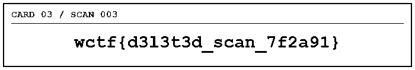

* TOC
{:toc}

## The Missing Scan

**Category**: forensics

**Author**: .ayushmk

**Description**: The camera card was cleared after its last scan, but the card itself survived. What did the missing scan show?

I get the challenge file:
```shell
file card.img  
card.img: DOS/MBR boot sector, code offset 0x3c+2, OEM-ID "MSDOS5.0", sectors/cluster 4, root entries 224, sectors 2880 (volumes <=32 MB), sectors/FAT 9, sectors/track 18, serial number 0x20260003, label: "CARD03     ", FAT (12 bit), followed by FAT
```

Use `fls` to look for deleted files:
```shell
fls -r -d card.img  
r/r * 3:        _CAN0003.PNG
```

Recover the file using `icat`:
```shell
icat card.img 3 > CAN0003.PNG  

file CAN0003.PNG  
CAN0003.PNG: PNG image data, 700 x 118, 1-bit grayscale, non-interlaced
```



`wctf{d3l3t3d_scan_7f2a91}`

___

## A Very Meta CTF

**Category**: forensics

**Author**: camelot007

**Description**: Ten pictures were found on a pirate's computer. Can you recover the message hidden in them?

I get the 10 challenge images:
```shell
$ls -al  
total 76  
drwxrwxr-x 1 user user  158 Nov 20 18:30 .  
drwxrwxr-x 1 user user   44 Nov 20 18:30 ..  
-rw-r--r-- 1 user user 2063 Dec 31  1969 eight.png  
-rw-r--r-- 1 user user 6616 Dec 31  1969 five.png  
-rw-r--r-- 1 user user 6738 Dec 31  1969 four.png  
-rw-r--r-- 1 user user 7729 Dec 31  1969 nine.png  
-rw-r--r-- 1 user user 7835 Dec 31  1969 one.png  
-rw-r--r-- 1 user user 6065 Dec 31  1969 seven.png  
-rw-r--r-- 1 user user 4254 Dec 31  1969 six.png  
-rw-r--r-- 1 user user 5161 Dec 31  1969 ten.png  
-rw-r--r-- 1 user user 6988 Dec 31  1969 three.png  
-rw-r--r-- 1 user user 6319 Dec 31  1969 two.png
```

There was hex in the user comment of each image:
```shell
exiftool * | grep "User Comment"  
User Comment                    : 7763  
User Comment                    : 7466  
User Comment                    : 7b74  
User Comment                    : 6831  
User Comment                    : 735f  
User Comment                    : 3173  
User Comment                    : 5f34  
User Comment                    : 5f66  
User Comment                    : 6c34  
User Comment                    : 675f4945306a3332657d
```

Put the hex in order and decode:
```shell
echo 776374667b746831735f31735f345f666c34675f4945306a3332657d | xxd -r -p  
wctf{th1s_1s_4_fl4g_IE0j32e}
```

`wctf{th1s_1s_4_fl4g_IE0j32e}`
